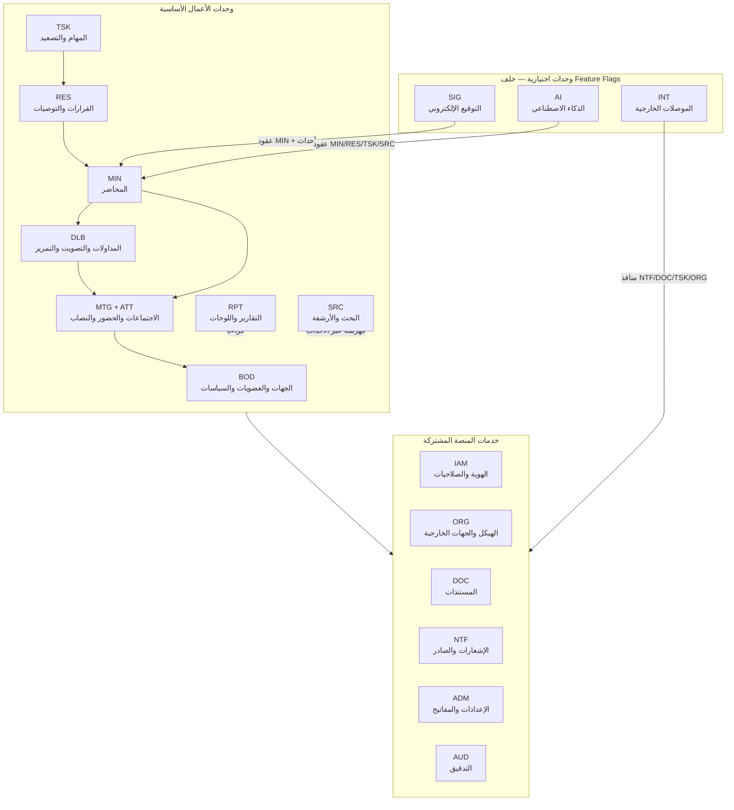
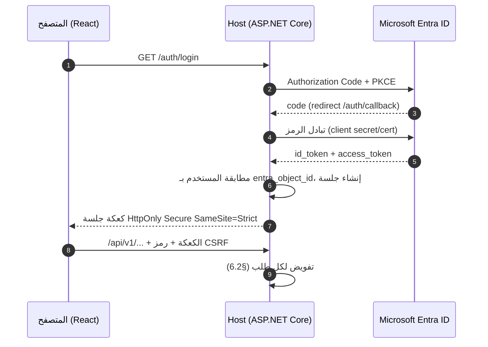
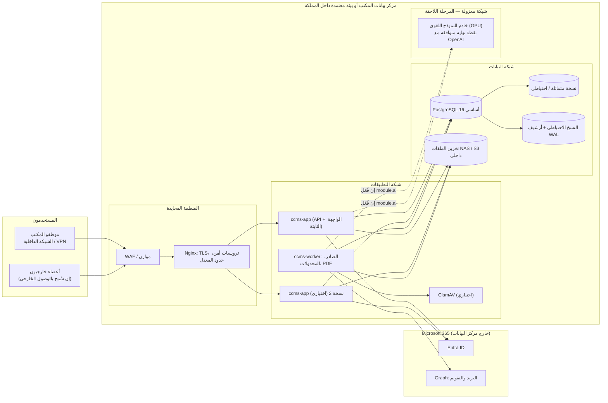
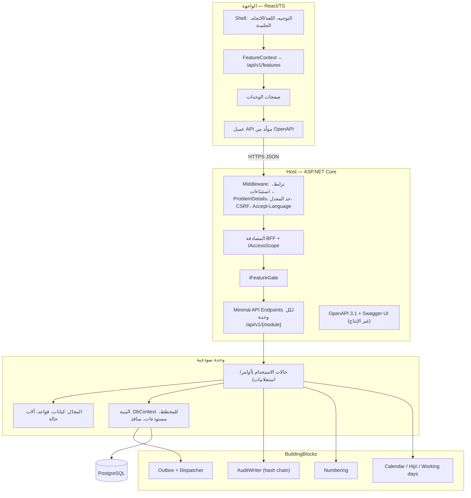

# 03 — معمارية النظام ومخطط المكونات

## 1. المحركات المعمارية

| المحرك | أثره على التصميم |
|---|---|
| فريق تقني صغير في المكتب يصون النظام بعد التسليم | تطبيق واحد قابل للنشر، وتقنيات شائعة، وأقل عدد من المكونات المتحركة |
| وحدات اختيارية تُفعّل وتُعطّل دون فقد بيانات (BRL-14) | الوحدات الأساسية لا تعتمد على الاختيارية؛ الاختيارية تعتمد على عقود الأساسية |
| نشر داخل مركز بيانات المكتب (NFR-DEP-01) | حاويات قياسية، وقاعدة بيانات مفتوحة المصدر، ولا خدمات سحابية مملوكة |
| بيانات مصنفة وحساسة (NFR-DAT-02) | تفويض في الخادم لكل طلب، ومرشّح صلاحيات داخل الاستعلام، وتدقيق مقاوم للتلاعب |
| تكاملات غير جاهزة بعد | محوّلات خلف واجهات، وبديل يدوي لكل تكامل |
| حجم متوسط (NFR-PRF-04) | لا حاجة لخدمات مصغّرة؛ التوسع الرأسي ونسخ إضافية من التطبيق كافيان |

## 2. النمط المعماري: Modular Monolith

تطبيق ASP.NET Core واحد يُنشر كصورة حاوية واحدة، بداخله وحدات أعمال مستقلة منطقيًا. لكل وحدة:

- **عقد عام** (`*.Contracts`): واجهات استعلام وأوامر عامة، وأحداث تكامل، وأنواع بيانات مشتركة. هو الشيء الوحيد الذي يجوز لوحدة أخرى الإشارة إليه.
- **داخل الوحدة** (`*.Core`): المجال، وحالات الاستخدام، والمستودعات، وسياق EF Core خاص بالوحدة، ونقاط النهاية.
- **مخطط مستقل** في قاعدة البيانات (`bodies`, `meetings`, ...). لا وحدة تكتب في مخطط غيرها، ولا مفاتيح أجنبية عابرة للمخططات إلا نحو `iam.users` و`org.org_units` للقراءة المرجعية (ADR-008).

لماذا لا خدمات مصغّرة الآن: الحجم والفريق لا يبرران كلفة التشغيل الموزع، والمعاملات عبر الوحدات (اعتماد محضر يُصدر قرارات ويُفعّل مهام) أبسط وأكثر موثوقية داخل عملية واحدة. الحدود الصارمة تُبقي استخراج وحدة إلى خدمة مستقلة ممكنًا لاحقًا (الذكاء الاصطناعي أول المرشحين بسبب حاجته لخادم GPU). التفاصيل في ADR-001.

## 3. المنظور المنطقي: الوحدات واعتمادياتها



**قاعدة الاتجاه:** الأسهم تعني «يعتمد على عقد». لا يوجد سهم من وحدة أساسية نحو وحدة اختيارية. حين تحتاج وحدة أساسية قدرة قد توفرها وحدة اختيارية، تُعرّف هي **منفذًا** (port) في عقدها، وتوفر الوحدة الاختيارية التنفيذ، ويوجد دائمًا تنفيذ افتراضي يدوي/فارغ (§5.5).

## 4. هيكل الحل (Solution)

```
src/
  Host/                         نقطة الإقلاع: تسجيل الوحدات، المصادقة، OpenAPI، الواجهة الثابتة
  BuildingBlocks/               أنواع مشتركة: Result، أحداث، Outbox، تدقيق، ترقيم، تقويم هجري، ProblemDetails
  Modules/
    Iam/        Iam.Contracts        Iam.Core
    Org/        Org.Contracts        Org.Core
    Bodies/     Bodies.Contracts     Bodies.Core
    Meetings/   Meetings.Contracts   Meetings.Core          (يشمل ATT)
    Deliberation/ Deliberation.Contracts Deliberation.Core
    Minutes/    Minutes.Contracts    Minutes.Core
    Resolutions/ Resolutions.Contracts Resolutions.Core
    Tasks/      Tasks.Contracts      Tasks.Core
    Documents/  Documents.Contracts  Documents.Core
    Notifications/ Notifications.Contracts Notifications.Core
    Reporting/  Reporting.Core                               (قراءة فقط عبر عروض SQL)
    Search/     Search.Contracts     Search.Core
    Configuration/ Configuration.Contracts Configuration.Core (Feature Flags والإعدادات)
    Audit/      Audit.Contracts      Audit.Core
    Optional/
      ESignature/   ESignature.Core   ESignature.Providers.*
      Ai/           Ai.Core           Ai.Providers.OpenAiCompatible
      Integrations/ Integrations.Graph  Integrations.Qemam  Integrations.Erp  Integrations.Sms  Integrations.SharePoint
web/                            React + TypeScript (Vite)
  src/modules/<module>/         صفحات ومكونات كل وحدة، وتُخفى الاختيارية حسب /api/v1/features
  src/api/                      عميل مولَّد من OpenAPI
tests/
  Architecture.Tests/           فرض حدود الوحدات (NFR-MNT-01)
  <Module>.Tests/               وحدات وتكامل بـ Testcontainers PostgreSQL
  Api.Contract.Tests/
  e2e/                          Playwright
deploy/                         Docker Compose، Nginx، نسخ احتياطي، دليل التشغيل
docs/                           هذه الوثائق
```

كل وحدة تُسجَّل في Host عبر `IModule` بطريقة واحدة: `RegisterServices`, `MapEndpoints`, `RegisterJobs`, `MigrationsAssembly`. الوحدات الاختيارية تُسجَّل دائمًا (جداولها وترحيلاتها موجودة)، ونقاط نهايتها ووظائفها محمية بمرشّح المفتاح؛ هكذا لا يؤدي التعطيل إلى فقد بيانات ولا يتطلب التفعيل ترحيلًا (ADR-005).

## 5. الاعتبارات المشتركة

### 5.1 التواصل بين الوحدات

| النمط | متى | مثال |
|---|---|---|
| استعلام متزامن عبر عقد | قراءة بيانات وحدة أخرى | MIN يطلب من MTG قائمة الحاضرين ونتيجة النصاب |
| أمر متزامن عبر عقد داخل المعاملة | خطوة يجب أن تنجح مع الأصل أو تفشل معه | اعتماد المحضر يستدعي `IResolutionIssuer.IssueFor(minutesVersionId)` و`ITaskActivator.ActivateFor(...)` في المعاملة نفسها |
| حدث تكامل عبر Outbox | ردود فعل غير لازمة لنجاح الأصل | `MinutesApproved` ← فهرسة البحث، إشعارات، تقويم، تضمين للذكاء الاصطناعي |

### 5.2 المعاملات والاتساق

- قاعدة بيانات واحدة تسمح بمعاملة واحدة عبر عدة سياقات EF Core تتشارك الاتصال نفسه (`DbConnection` + `DbTransaction`) لعمليات مثل الاعتماد.
- التحكم التفاؤلي في التزامن بعمود `xmin` في PostgreSQL، ويُعرض للعميل كـ ETag (NFR-DAT-06).
- الترقيم (اجتماعات، قرارات، مهام) من جدول `config.numbering_sequences` بقفل صف داخل المعاملة لضمان عدم التكرار وعدم الفجوات قدر الإمكان.

### 5.3 صندوق الصادر (Outbox) والأحداث

1. حالة الاستخدام تحفظ تغييراتها وتضيف أحداثها إلى `notify.outbox_messages` (للإشعارات) أو `config.integration_events` (لأحداث التكامل) **في المعاملة نفسها**.
2. عامل خلفي يقرأ الدفعات بـ `FOR UPDATE SKIP LOCKED`، ويوزع على المعالجات، ويعلّم الحالة.
3. لكل رسالة مفتاح منع تكرار فريد، ومعالجات متساوية الأثر (idempotent)، وإعادة محاولة بتراجع أسّي، وحالة «فاشل» بعد الحد مع تنبيه.
4. فشل أي معالج (بريد، تقويم، فهرسة، ذكاء اصطناعي) لا يُرجع العملية الأصلية ولا يمنعها.

### 5.4 كتالوج الأحداث

| الحدث | المصدر | المستهلكون | إشعار إلى |
|---|---|---|---|
| `BodyActivated` / `BodyDissolved` | BOD | SRC، RPT | أعضاء الجهة |
| `MembershipChanged` | BOD | IAM (تحديث ذاكرة الصلاحيات)، NTF | العضو، أمين السر |
| `MeetingScheduled` / `MeetingRescheduled` / `MeetingCancelled` | MTG | NTF، INT (التقويم) | المدعوون |
| `AgendaPublished` | MTG | NTF، AI (تلخيص المذكرات إن فُعّل) | المدعوون |
| `InvitationResponded` | MTG | MTG (توقع النصاب) | أمين السر |
| `QuorumNotMet` | ATT | NTF | الرئيس، أمين السر |
| `VoteOpened` / `VoteClosed` | DLB | NTF | المصوتون المؤهلون |
| `CirculationOpened` / `CirculationClosed` | DLB | NTF | الأعضاء المصوتون |
| `MinutesSubmittedForReview` | MIN | NTF | الأعضاء الحاضرون |
| `MinutesSignOffRequested` | MIN | NTF، SIG (إن كانت الطريقة إلكترونية) | الموقّعون المطلوبون |
| `MinutesSignOffsCompleted` | MIN | NTF | الرئيس |
| `MinutesReturned` | MIN | NTF | أمين السر |
| `MinutesApproved` | MIN | RES، TSK (داخل المعاملة)، SRC، NTF، SIG (توقيع الرئيس)، AI (فهرسة دلالية) | الأعضاء |
| `ResolutionIssued` / `ResolutionCancelled` | RES | SRC، NTF | الجهة، الجهة الأم للتوصيات |
| `TaskAssigned` / `TaskReassigned` | TSK | NTF، INT (المراسلات للجهات الخارجية) | المكلَّف، المسؤول المتابِع |
| `TaskStarted` | TSK | RES (تحويل القرار إلى `in_execution`) | — |
| `TaskDueSoon` / `TaskOverdue` / `TaskEscalated` | TSK (مجدول) | NTF | حسب مستوى التصعيد |
| `TaskSubmittedForVerification` / `TaskVerified` / `TaskReturned` | TSK | NTF | المحقق / المكلَّف |
| `TaskExtensionRequested` / `TaskExtensionDecided` | TSK | NTF | صاحب القرار / المكلَّف |
| `FeatureFlagChanged` | ADM | كل الوحدات (تحديث الذاكرة المؤقتة)، AUD | مديرو النظام |
| `SignatureCompleted` / `SignatureFailed` | SIG | MIN | أمين السر |
| `AiSuggestionReady` | AI | NTF | طالب الاقتراح |

### 5.5 نقاط الامتداد للوحدات الاختيارية

| المنفذ (في عقد الوحدة الأساسية) | التنفيذ الافتراضي (دائمًا موجود) | تنفيذ الوحدة الاختيارية |
|---|---|---|
| `Minutes.Contracts.ISignOffChannel` | `AttestationChannel` (إقرار داخلي)، `WetSignatureEvidenceChannel` (رفع دليل ورقي) | `ESignatureChannel` من SIG |
| `Notifications.Contracts.IEmailSender` | `OutboxLogOnlySender` (يسجل ولا يرسل) | `GraphMailSender` أو `SmtpSender` من INT |
| `Meetings.Contracts.ICalendarPublisher` | `NoCalendarPublisher` (ملف .ics مرفق بالبريد) | `GraphCalendarPublisher` |
| `Tasks.Contracts.IOutgoingCorrespondence` | `ManualCorrespondenceReference` (إدخال رقم الخطاب يدويًا) | `QemamCorrespondence` |
| `Org.Contracts.IDirectorySource` | `ManualDirectory` + الاستيراد من ملف | `EntraDirectorySource`، `ErpDirectorySource` |
| `Documents.Contracts.IFileStore` | `FileSystemStore` (مجلد/NAS) | `S3CompatibleStore`، `SharePointStore` |
| `Documents.Contracts.IMalwareScanner` | `NotScannedScanner` (يعلّم «لم يُفحص») | `ClamAvScanner` |
| `Search.Contracts.ISemanticRetriever` | غير موجود — البحث النصي فقط | `AiSemanticRetriever` |

اختيار التنفيذ يتم وقت الطلب عبر `IFeatureGate`: إن كان المفتاح معطلًا يُستخدم الافتراضي. لا يحتاج تبديل التنفيذ إعادة تشغيل.

### 5.6 المهام الخلفية والمجدولة

Quartz.NET بمخزن مهام في PostgreSQL (وضع cluster لمنع التشغيل المزدوج عند تعدد النسخ) — ADR-010.

| المهمة | التكرار الافتراضي | الوحدة |
|---|---|---|
| توزيع صندوق الصادر وأحداث التكامل | كل 10 ثوانٍ | NTF |
| تقييم التذكيرات والتصعيد | يوميًا 07:30 بتوقيت الرياض + عند كل تغيير موعد | TSK |
| تنبيه مهلة مراجعة المحضر | يوميًا | MIN |
| إغلاق التمرير عند انتهاء المهلة | كل 5 دقائق | DLB |
| تطبيق سياسات الاحتفاظ والأرشفة | أسبوعيًا | SRC |
| فحص سلامة سلسلة التدقيق | يوميًا | AUD |
| فحص صحة الموصلات | كل 5 دقائق | INT |
| مزامنة حالات طلبات التوقيع | كل 15 دقيقة | SIG |

العامل الخلفي هو الصورة نفسها بدور `--role=worker`؛ يمكن تشغيله في الحاوية نفسها للبيئات الصغيرة أو منفصلًا.

### 5.7 اللغة والتاريخ

- الواجهة: `react-i18next`، واتجاه الصفحة يتبع اللغة، ومكتبة المكونات بإعداد RTL.
- الخلفية: رسائل الأخطاء ProblemDetails بلغة `Accept-Language`، والقوالب ثنائية اللغة.
- الحقول النصية الرسمية ثنائية: `name_ar` إلزامي، `name_en` اختياري.
- التواريخ مخزنة `timestamptz` بـ UTC؛ التواريخ الصرفة (مواعيد المهام) `date` بتوقيت الرياض؛ التحويل الهجري بـ `UmAlQuraCalendar` في .NET وبمكتبة مكافئة في الواجهة.
- حساب «أيام العمل» يستخدم تقويم الإجازات الرسمية في الإعدادات (FR-ADM-04).

### 5.8 إصدار PDF

القالب HTML/CSS بترويسة المكتب، ويُحوَّل بمحرك Chromium بلا واجهة (Playwright) داخل حاوية العامل، لأن تشكيل العربية وثنائية الاتجاه فيه موثوقان. الخطوط مضمنة ومرخصة (ADR-011).

### 5.9 البحث

PostgreSQL Full-Text Search بإعداد `simple` على نص مُطبَّع عربيًا في التطبيق (FR-SRC-03) + `pg_trgm` للتقريب. جدول فهرس موحد `search.search_documents` يحمل `body_id` والتصنيف لتطبيق مرشّح الصلاحيات داخل الاستعلام. يُحدَّث عبر الأحداث. البحث الدلالي يضيفه AI فوقه ولا يستبدله (ADR-013).

## 6. معمارية الأمن

### 6.1 الدخول (BFF)



لا يحتفظ المتصفح بأي رمز وصول. الواجهة وAPI من الأصل نفسه، فلا حاجة لـ CORS. الجلسات محفوظة في جدول `iam.sessions` (يسمح بالخروج من كل الأجهزة وبتعدد نسخ التطبيق).

### 6.2 مسار التفويض لكل طلب

1. **المصادقة:** جلسة صالحة ← `CurrentUser`.
2. **مرشّح المفتاح:** نقطة النهاية تتبع وحدة أو قدرة معطلة ← 404 بنوع `feature-disabled`.
3. **الصلاحية:** هل يملك المستخدم الصلاحية المطلوبة (06-rbac §3) في **النطاق** (نظامي أو جهة بعينها) — من أدواره النظامية وعضوياته السارية وتفويضاته.
4. **القيود السياقية:** التصنيف ≤ تصريح المستخدم، وتعارض المصالح، وفصل المهام، وحالة السجل.
5. **مرشّح على مستوى البيانات:** كل استعلام قائمة يمر بـ `IAccessScope` الذي يضيف شرط الجهات المسموحة؛ وأي سجل خارج النطاق يعيد 404 لا 403 (NFR-SEC-08).

### 6.3 حماية البيانات

- حساب قاعدة البيانات للتطبيق بلا صلاحية DDL في الإنتاج؛ الترحيلات بحساب منفصل وقت النشر.
- حساب التطبيق لا يملك UPDATE/DELETE على `audit.audit_events` (FR-AUD-05).
- أسرار الموصلات في `config.settings` مشفرة بـ ASP.NET Data Protection بمفتاح خارج القاعدة.
- لا تُكتب محتويات المحاضر والمذكرات في السجلات التشغيلية.

### 6.4 العمليات المُدقَّقة (حد أدنى)

الدخول والخروج وفشل الدخول؛ إسناد الأدوار والتفويضات؛ إنشاء الجهة وتغيير حالتها وسياستها وعضوياتها؛ إنشاء الاجتماع وتأجيله وإلغاؤه ونشر جدول أعماله؛ تسجيل الحضور وفحوص النصاب؛ فتح التصويت وإغلاقه (دون الصوت في السري)؛ كل انتقال حالة للمحضر وكل إقرار وإبطال؛ الاعتماد والإعادة والتصحيح؛ إصدار القرارات وإلغاؤها؛ إسناد المهام وتحديث حالاتها والتمديد والتحقق والإلغاء؛ تنزيل المرفقات المصنفة واطلاع السجلات السرية؛ تغيير المفاتيح والإعدادات والقوالب؛ كل استدعاء ذكاء اصطناعي وقبول أو رفض اقتراحاته؛ كل طلب توقيع ونتيجته؛ تصدير التقارير.

## 7. التكاملات الخارجية

**لا يوجد أي تكامل جاهز.** كل تكامل أدناه مصمم ولا يُفعَّل إلا بعد توفر ما في العمود الأخير واجتياز اختبار الموصل.

| الموصل | الغرض | المفتاح | البديل عند التعطيل | الحالة | المطلوب للتفعيل |
|---|---|---|---|---|---|
| Entra ID (OIDC) | الدخول الموحد | — (أساسي) | لا يوجد في الإنتاج؛ دخول تطويري في التطوير فقط | مصمم | تسجيل تطبيق، Tenant/Client ID، سر أو شهادة (Q-03) |
| Microsoft Graph — البريد | إرسال الإشعارات | `integrations.graph_mail` | الصادر يُسجَّل؛ أو SMTP داخلي (`integrations.smtp`) | مصمم | صندوق خدمي وصلاحية `Mail.Send` محصورة فيه عبر RBAC for Applications (Q-04) |
| Microsoft Graph — التقويم | أحداث الاجتماعات وردودها | `integrations.graph_calendar` | ملف .ics مع البريد، والردود داخل النظام | مصمم | `Calendars.ReadWrite` محصورة في الصندوق الخدمي (Q-04) |
| SMTP داخلي | بديل البريد | `integrations.smtp` | الصادر يُسجَّل | مصمم | عنوان الخادم وبيانات الاعتماد (Q-04) |
| نظام المراسلات (قمم) | خطابات المهام الخارجية | `integrations.qemam` | إدخال رقم الخطاب يدويًا | **غير معروف الواجهة** | توثيق API وبيئة اختبار وبيانات اعتماد (Q-07) |
| ERP / الموارد البشرية | الهيكل والموظفون | `integrations.erp_directory` | إدارة يدوية + استيراد ملف | **غير معروف الواجهة** | اسم النظام وواجهته (Q-08) |
| Entra ID — الدليل | مزامنة الموظفين والمديرين | `integrations.entra_directory` | الإنشاء عند أول دخول | مصمم | صلاحية `User.Read.All` (Q-03) |
| مزوّد توقيع معتمد | التوقيع الإلكتروني | `esign.provider` | الإقرار الداخلي / الدليل الورقي | **غير متعاقد** | اختيار المزوّد والتعاقد وواجهاته (Q-09) |
| بوابة الرسائل النصية | تصعيد عالٍ | `integrations.sms` | البريد والإشعار الداخلي | **غير متعاقد** | المزوّد واسم المرسل (Q-10) |
| SharePoint | تخزين المستندات | `integrations.sharepoint_storage` | تخزين الملفات المحلي | مصمم | موقع ومكتبة وصلاحيات `Sites.Selected` (Q-11) |
| ClamAV أو حل المكتب | فحص المرفقات | `documents.malware_scan` | «لم يُفحص» | مصمم | حاوية ClamAV داخلية أو واجهة حل المكتب (Q-15) |
| خادم النموذج اللغوي | وحدة AI | `module.ai` | لا ذكاء اصطناعي | **غير متوفر** | خادم داخلي بمعالج رسومي أو مزوّد معتمد داخل المملكة (Q-16) |

## 8. منظور النشر



### 8.1 التحجيم المبدئي للإنتاج

| المكون | المواصفة المقترحة |
|---|---|
| خادم التطبيق والعامل | 4 vCPU، 16 GB RAM (يتسع لـ Chromium لإصدار PDF) |
| PostgreSQL | 4 vCPU، 16 GB RAM، 200 GB SSD + نسخة متماثلة بالمواصفة نفسها |
| تخزين الملفات | 500 GB قابلة للتوسع |
| النسخ الاحتياطي | 2 TB في موقع ثانٍ داخل المملكة |
| خادم النموذج (مرحلة لاحقة) | يُحدد بعد اختيار النموذج في مرحلة AI (10 §7) |

### 8.2 البيئات

تطوير محلي (Docker Compose)، اختبار، ما قبل الإنتاج (مطابقة للإنتاج ببيانات مُخفاة)، إنتاج. نسخة عرض بيانات وهمية اختيارية على استضافة خارجية **لا تحمل أي بيانات حقيقية** وتعمل بالدخول التجريبي (كما في الإصدار 0.5).

## 9. مخطط المكونات داخل التطبيق



## 10. حزمة التقنيات

| الطبقة | الاختيار | ملاحظة |
|---|---|---|
| الخلفية | .NET 10 LTS، ASP.NET Core Minimal APIs، C# | دعم طويل الأمد (ADR-002) |
| الوصول للبيانات | EF Core 10 + Npgsql، سياق لكل وحدة | ترحيلات لكل وحدة |
| التحقق | FluentValidation | رسائل ثنائية اللغة |
| التوثيق | OpenAPI 3.1 عبر Microsoft.AspNetCore.OpenApi + Swagger UI | ADR-014 |
| المهام | Quartz.NET (PostgreSQL job store) | ADR-010 |
| السجلات والتتبع | Serilog (JSON) + OpenTelemetry | NFR-OBS-01/02 |
| PDF | Playwright/Chromium من قالب HTML | ADR-011 |
| الواجهة | React 19 + TypeScript + Vite | — |
| مكونات الواجهة | Ant Design 5 بإعداد RTL ومحلية عربية، بهوية المكتب | ADR-007 |
| البيانات في الواجهة | TanStack Query، React Router، react-hook-form + zod | — |
| الترجمة | react-i18next | NFR-USA-01 |
| المحرر | محرر نص منسق يدعم RTL (TipTap) بمخرجات JSON منظمة | محتوى المحضر |
| قاعدة البيانات | PostgreSQL 16+ مع `pg_trgm`، و`pgvector` عند تفعيل AI | ADR-003 |
| الوكيل العكسي | Nginx | — |
| الحاويات | Docker/OCI، Compose للبيئات الصغيرة، قابلة لـ Kubernetes لاحقًا | ADR-009 |
| الاختبارات | xUnit، Testcontainers، NetArchTest، Playwright، k6، axe | 12-test-plan |
