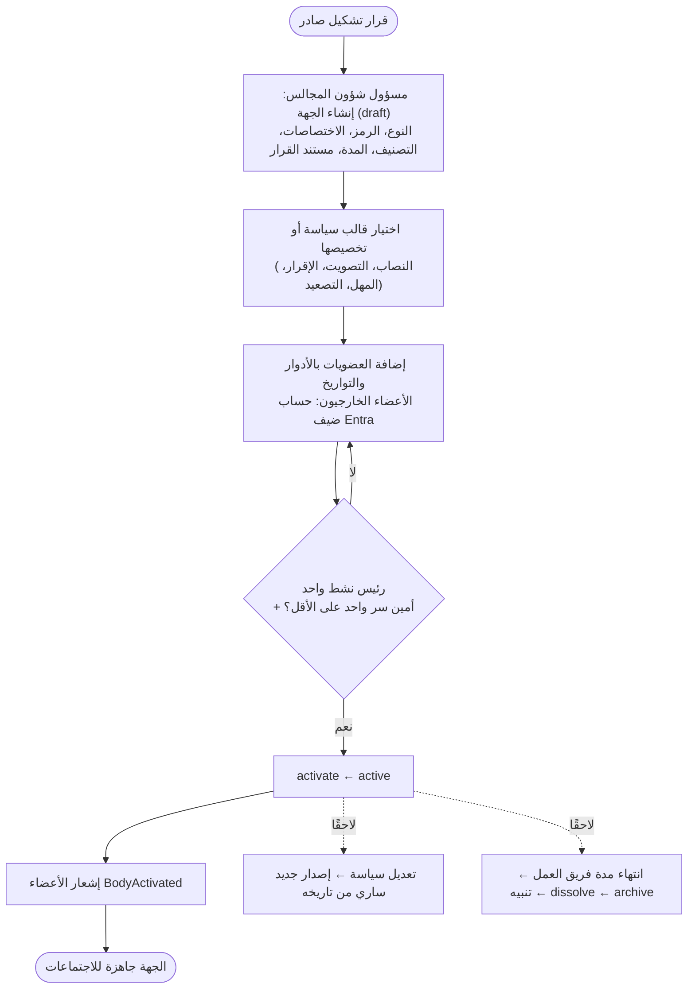
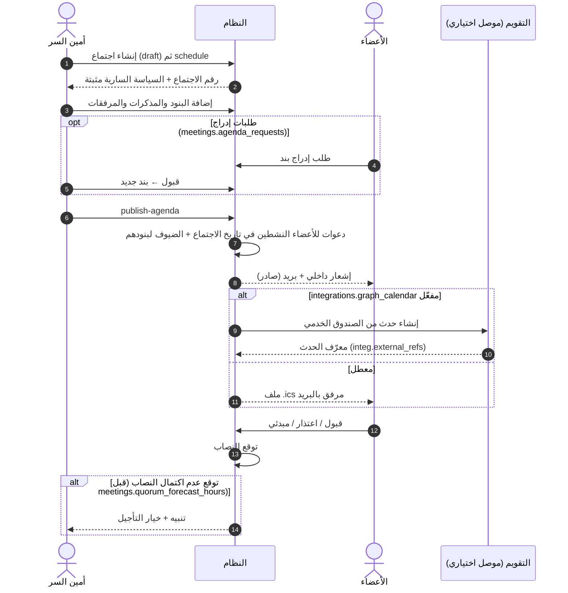
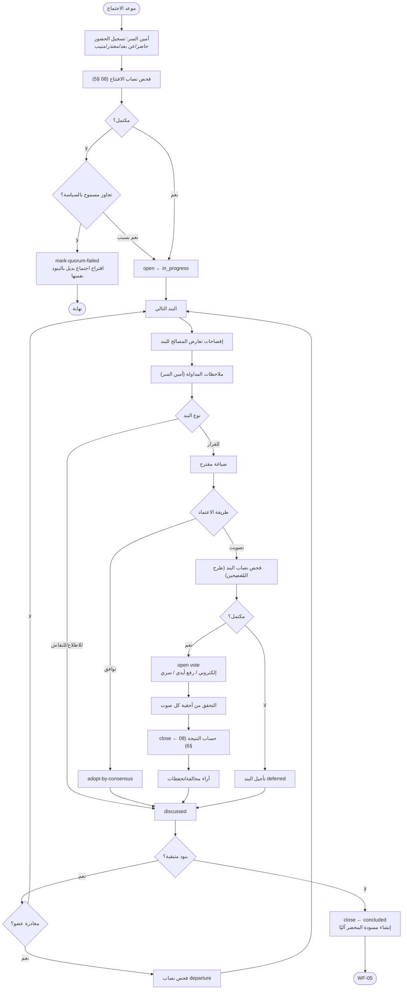
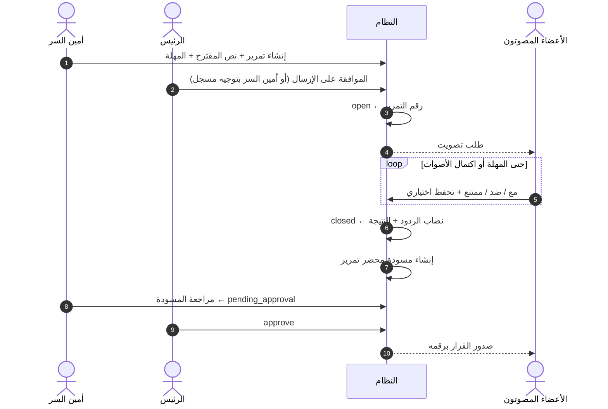
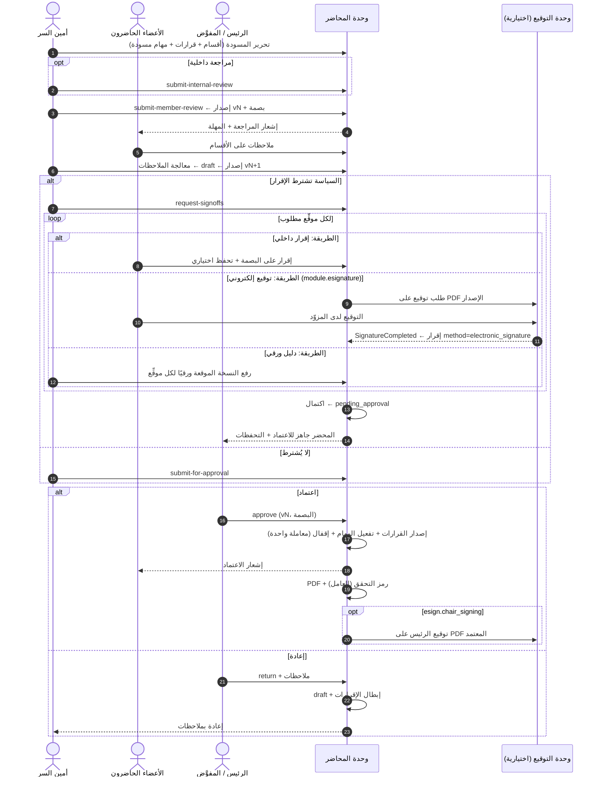
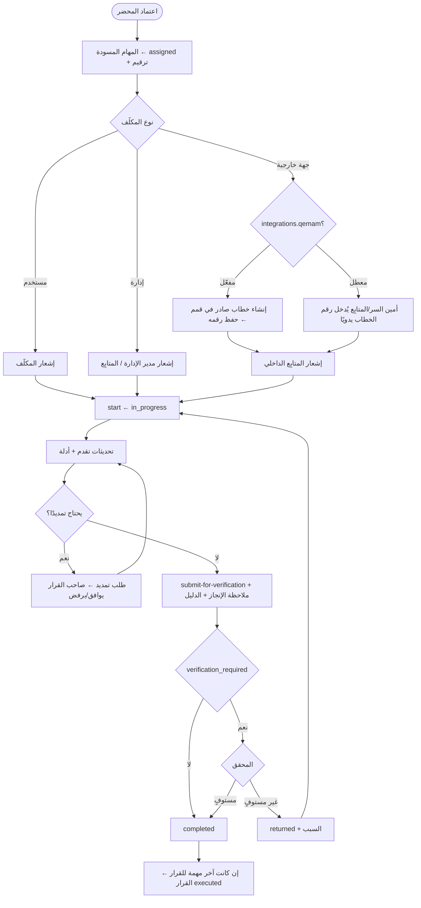
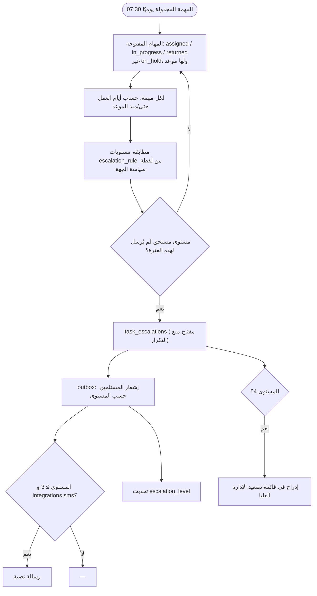
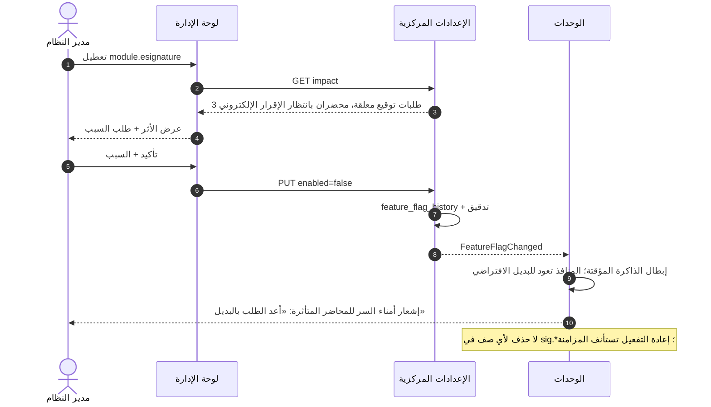
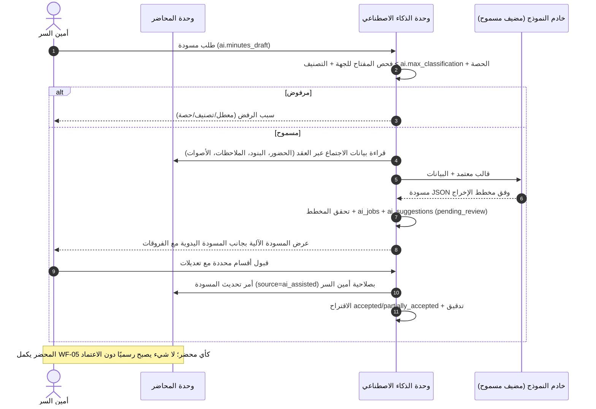
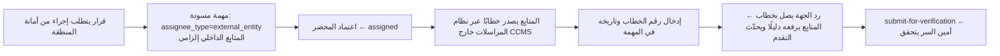

# 04 — مخططات سير العمل

المخططات تصف التسلسل والمسؤوليات؛ الحالات وقواعد الانتقال الملزمة في [08](08-minutes-decisions-tasks-lifecycle.md)، والصلاحيات في [06](06-rbac.md).

## WF-01 تشكيل جهة حوكمة

## WF-02 إعداد الاجتماع والدعوات

## WF-03 انعقاد الاجتماع: الحضور والنصاب والمداولة والتصويت

## WF-04 القرار بالتمرير

## WF-05 مراجعة المحضر وإقراره واعتماده

## WF-06 تنفيذ المهمة والتحقق منها

## WF-07 التذكير والتصعيد اليومي

## WF-08 تفعيل أو تعطيل وحدة اختيارية

## WF-09 مسودة محضر بمساعدة الذكاء الاصطناعي (اختيارية)

## WF-10 إسناد مهمة لجهة خارجية دون موصل

