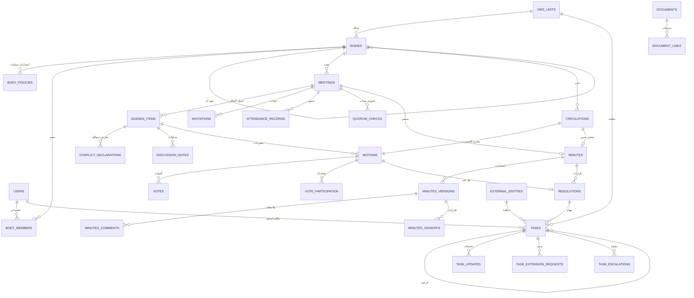
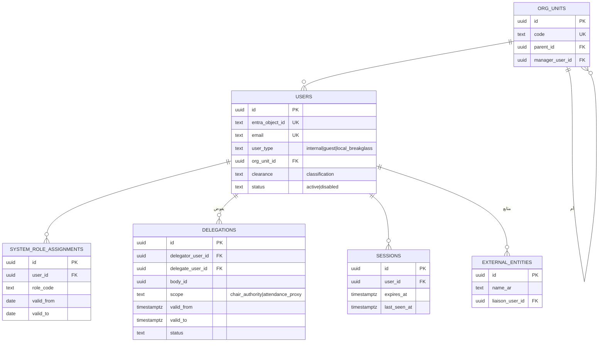
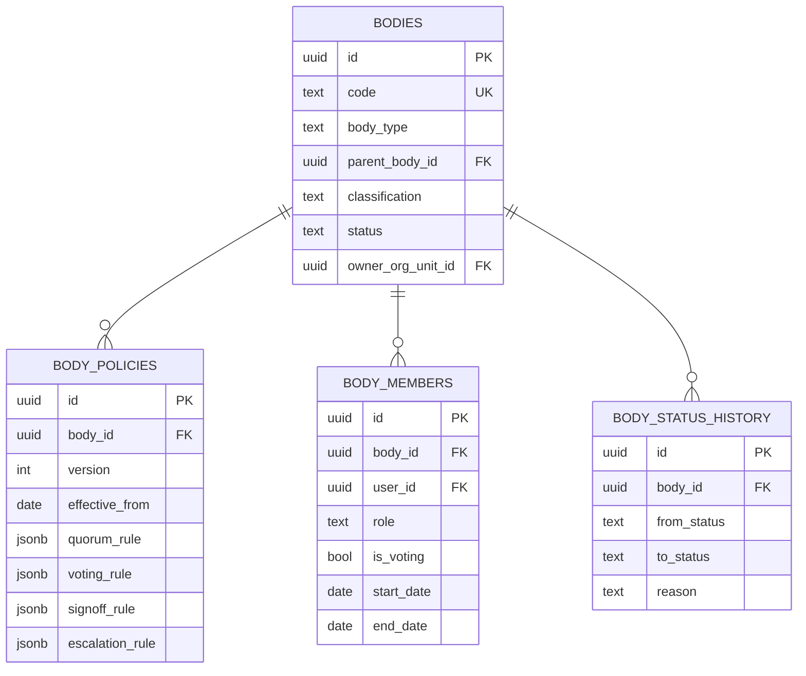
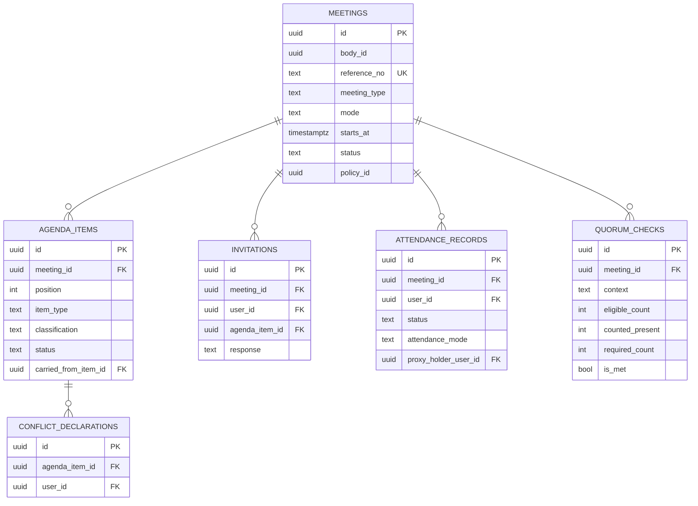
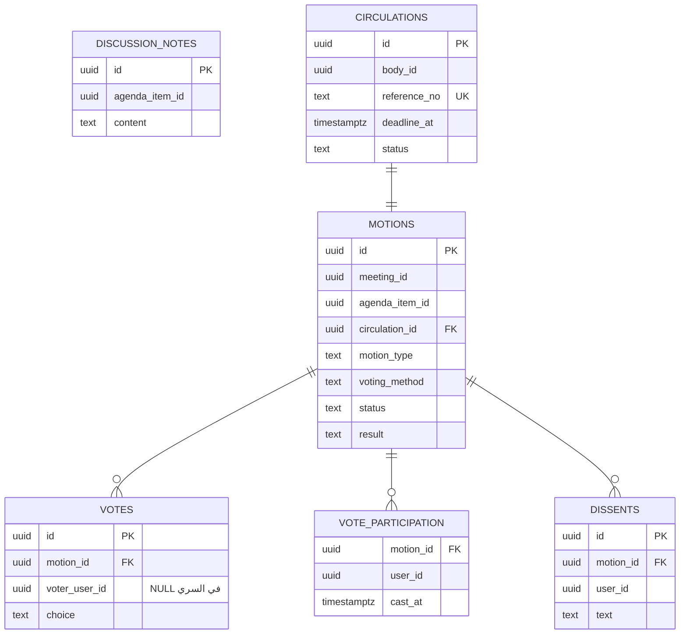
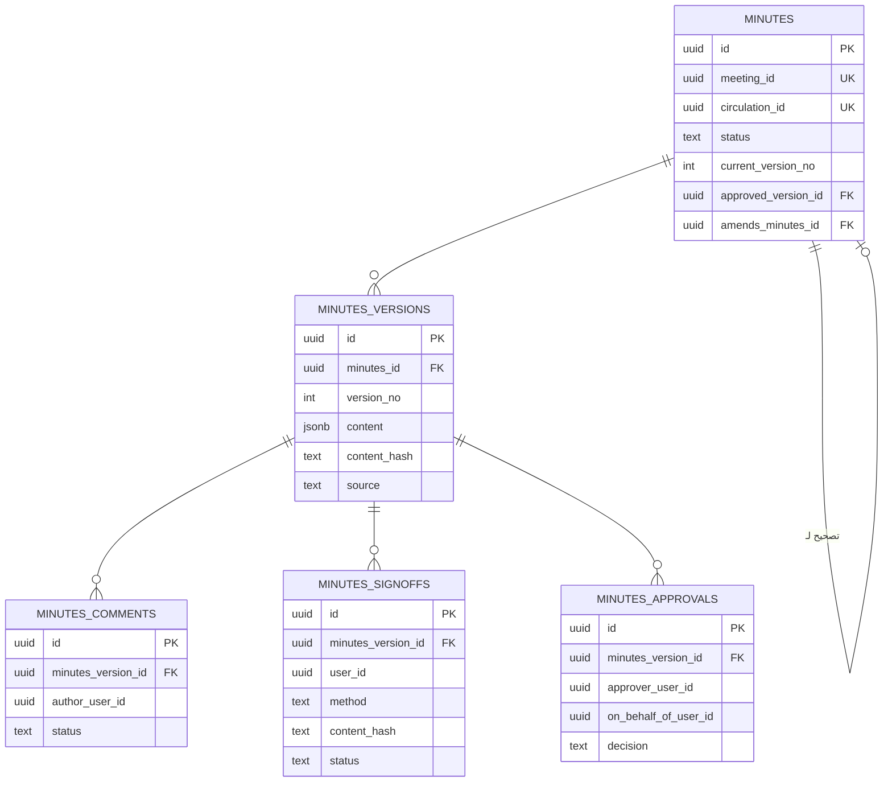
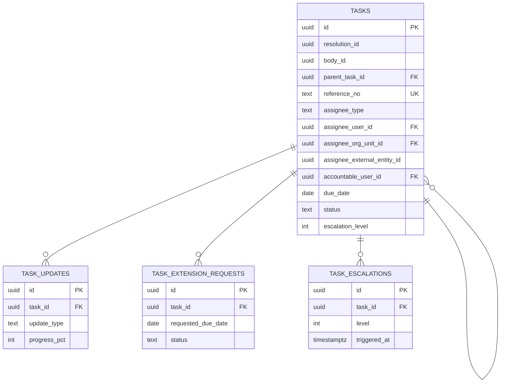

# 05 — نموذج البيانات (ERD) وقاموس البيانات

قاعدة بيانات PostgreSQL واحدة (ADR-003)، بمخطط (schema) لكل وحدة. الأسماء بالإنجليزية بصيغة snake_case، والقيم النصية المعدودة (enums) مخزنة كنص مقيد بـ `CHECK` لتسهيل الترحيل والقراءة.

## 1. اصطلاحات عامة

| البند | القاعدة |
|---|---|
| المفتاح الأساسي | `id uuid` مولّد في التطبيق (UUIDv7 لترتيب زمني) — عدا `audit.audit_events` (`bigint identity`) |
| أعمدة التتبع | `created_at timestamptz`, `created_by uuid`, `updated_at timestamptz`, `updated_by uuid` في كل جدول قابل للتعديل (لا تُكرر في القاموس أدناه) |
| التزامن | عمود النظام `xmin` كرمز تزامن تفاؤلي، يُعرض كـ ETag |
| الحذف | لا حذف فعلي لسجلات الحوكمة؛ `deleted_at` للمسودات فقط حيث يُذكر |
| النصوص ثنائية اللغة | `*_ar` إلزامي، `*_en` اختياري |
| التصنيف | `classification text` ∈ `public`, `restricted`, `secret`, `top_secret` |
| المراجع العابرة | مسموح بمفاتيح أجنبية نحو `iam.users(id)` و`org.org_units(id)` فقط؛ غيرها معرّف بلا قيد أجنبي، وسلامته مسؤولية الوحدة المالكة (ADR-008) |
| لقطات السياسة | ما يُحتسب وفق سياسة (النصاب، التصويت) يحفظ لقطة القاعدة `rule_snapshot jsonb` مع إصدار السياسة (BRL-05) |

## 2. المخطط الكلي

## 3. المخططات التفصيلية

### 3.1 الهوية والهيكل — `iam`, `org`

#### iam.users
| العمود | النوع | ملاحظات |
|---|---|---|
| id | uuid | PK |
| entra_object_id | text | فريد، فارغ لحساب الطوارئ |
| email | text | فريد، صغير الأحرف |
| display_name_ar / display_name_en | text | — |
| job_title | text | — |
| user_type | text | `internal`, `guest`, `local_breakglass` |
| org_unit_id | uuid | FK → org.org_units، اختياري |
| clearance | text | أعلى تصنيف مسموح بالاطلاع عليه؛ افتراضي `restricted` |
| preferred_language | text | `ar`, `en` |
| preferred_calendar | text | `gregorian`, `hijri` |
| status | text | `active`, `disabled` |
| last_login_at | timestamptz | — |

#### iam.system_role_assignments
`id`, `user_id` (FK)، `role_code` text ∈ أدوار 06-rbac §2، `valid_from` date، `valid_to` date فارغ = مفتوح، `granted_by` uuid، `reason` text. قيد: لا تداخل لنفس المستخدم والدور.

#### iam.delegations
`id`، `delegator_user_id`، `delegate_user_id`، `body_id` (فارغ = كل جهات المفوِّض)، `scope` ∈ `chair_authority`, `attendance_proxy`، `valid_from`، `valid_to`، `reason`، `status` ∈ `active`, `revoked`, `expired`، `revoked_by`، `revoked_at`. قيد: المفوَّض ليس المفوِّض.

#### iam.sessions
`id`، `user_id`، `created_at`، `last_seen_at`، `expires_at`، `ip`، `user_agent_hash`، `revoked_at`.

#### org.org_units
`id`، `code` فريد، `name_ar`، `name_en`، `parent_id`، `manager_user_id`، `external_ref` (معرّف في ERP)، `status` ∈ `active`, `inactive`.

#### org.external_entities
`id`، `name_ar`، `name_en`، `entity_type` (قائمة مرجعية: وزارة، هيئة، أمانة، شركة...)، `contact_name`، `contact_email`، `contact_phone`، `liaison_user_id` (FK، إلزامي — BRL-09)، `correspondence_code` (رمز الجهة في نظام المراسلات إن وُجد)، `status`.

### 3.2 الجهات — `bodies`

#### bodies.bodies
| العمود | النوع | ملاحظات |
|---|---|---|
| id | uuid | PK |
| code | text | فريد، أحرف لاتينية وأرقام، يُستخدم في الترقيم |
| body_type | text | `council`, `committee`, `sub_committee`, `working_team` |
| name_ar / name_en | text | — |
| parent_body_id | uuid | FK ذاتي، اختياري |
| mandate_ar / mandate_en | text | الاختصاصات |
| formation_decision_no / formation_decision_date | text / date | — |
| formation_document_id | uuid | → docs.documents |
| term_start / term_end | date | `term_end` إلزامي لـ `working_team` |
| classification | text | — |
| owner_org_unit_id | uuid | FK → org.org_units |
| minutes_template_code | text | قالب المحضر |
| status | text | `draft`, `active`, `suspended`, `dissolved`, `archived` |

#### bodies.body_policies
| العمود | النوع | ملاحظات |
|---|---|---|
| id | uuid | PK |
| body_id | uuid | FK |
| version | int | فريد مع body_id |
| effective_from | date | السياسة السارية = أعلى إصدار بتاريخ ≤ تاريخ الاجتماع |
| quorum_rule | jsonb | مخطط في 08 §5 |
| voting_rule | jsonb | مخطط في 08 §6 |
| signoff_rule | jsonb | `{"required":bool,"signers":"present_voting_members_except_chair","methods":["attestation","electronic_signature","wet_signature_evidence"],"chair_esign_on_approval":bool}` |
| minutes_review_days | int | مهلة مراجعة الأعضاء بأيام العمل |
| minutes_approval_target_days | int | مستهدف الاعتماد بعد الانعقاد |
| escalation_rule | jsonb | مخطط في 08 §4.3 |
| extension_approver | text | `secretary`, `chair` |
| allow_proxy / max_proxies_per_member | bool / int | — |
| allow_remote_attendance | bool | — |
| allow_circulation | bool | — |
| evidence_required | bool | يُشترط دليل مرفق لتقديم المهمة للتحقق |
| approved_by / approved_at | uuid / timestamptz | — |

#### bodies.body_members
| العمود | النوع | ملاحظات |
|---|---|---|
| id | uuid | PK |
| body_id | uuid | FK |
| user_id | uuid | FK → iam.users (الخارجي حساب ضيف) |
| role | text | `chair`, `vice_chair`, `secretary`, `assistant_secretary`, `member`, `advisor`, `observer` |
| is_voting | bool | افتراضي true لـ chair/vice_chair/member، false لغيرهم |
| represents_entity_id | uuid | → org.external_entities، اختياري |
| start_date / end_date | date | — |
| appointment_ref | text | سند التعيين |
| status | text | `active`, `ended` |

قيود: فهرس فريد جزئي يمنع أكثر من `chair` نشط متداخل الفترات لنفس الجهة؛ ومثله لـ `vice_chair`.

#### bodies.body_status_history
`id`، `body_id`، `from_status`، `to_status`، `reason`، `reference_no`، `changed_by`، `changed_at`.

### 3.3 الاجتماعات والحضور — `meetings`

#### meetings.meetings
| العمود | النوع | ملاحظات |
|---|---|---|
| id | uuid | PK |
| body_id | uuid | مرجع bodies.bodies |
| sequence_year / sequence_no | int / int | — |
| reference_no | text | فريد، `{code}-{year}-{seq}` |
| title_ar / title_en | text | — |
| meeting_type | text | `regular`, `extraordinary` |
| mode | text | `in_person`, `remote`, `hybrid` |
| starts_at / planned_end_at | timestamptz | — |
| location / online_link | text | — |
| status | text | قيم 08 §1 |
| policy_id | uuid | إصدار السياسة الساري، يُثبَّت عند الجدولة ويُعاد حسابه عند تغيير الموعد |
| opened_at / closed_at | timestamptz | — |
| cancellation_reason | text | — |
| postponed_to_meeting_id | uuid | FK ذاتي |
| agenda_published_at | timestamptz | — |
| classification | text | ≥ تصنيف الجهة |

#### meetings.agenda_items
`id`، `meeting_id`، `position` (فريد مع meeting_id)، `title_ar`، `title_en`، `description`، `item_type` ∈ `for_decision`, `for_information`, `for_discussion`، `presenter_user_id`، `presenter_text`، `requesting_org_unit_id`، `estimated_minutes`، `classification`، `status` ∈ `pending`, `discussed`, `deferred`, `withdrawn`، `carried_from_item_id` (FK ذاتي)، `memo_text`.

#### meetings.agenda_item_requests
`id`، `body_id`، `requested_by`، `requesting_org_unit_id`، `title`، `justification`، `status` ∈ `submitted`, `accepted`, `rejected`، `decided_by`، `decision_note`، `agenda_item_id`.

#### meetings.invitations
`id`، `meeting_id`، `user_id`، `invitee_kind` ∈ `member`, `guest`، `agenda_item_id` (للضيف المحصور ببند)، `sent_at`، `response` ∈ `pending`, `accepted`, `declined`, `tentative`، `response_note`، `responded_at`، `response_source` ∈ `in_app`, `calendar`, `secretary`.

#### meetings.attendance_records
`id`، `meeting_id`، `user_id`، `body_member_id` (فارغ للضيف)، `status` ∈ `present`, `absent`, `excused`, `represented_by_proxy`، `attendance_mode` ∈ `in_person`, `remote`، `proxy_holder_user_id`، `arrived_at`، `left_at`، `recorded_by`. فريد (meeting_id, user_id).

#### meetings.quorum_checks
`id`، `meeting_id`، `motion_id` (فارغ لفحص الافتتاح)، `context` ∈ `opening`, `vote`, `departure`, `manual`، `checked_at`، `eligible_count`، `counted_present`، `required_count`، `is_met`، `override_reason` (إن سمحت السياسة)، `rule_snapshot` jsonb، `checked_by`.

#### meetings.conflict_declarations
`id`، `meeting_id`، `agenda_item_id`، `user_id`، `reason`، `declared_at`، `recorded_by`. فريد (agenda_item_id, user_id).

### 3.4 المداولات والتصويت — `deliberation`

#### deliberation.discussion_notes
`id`، `meeting_id`، `agenda_item_id`، `author_user_id`، `content` (JSON المحرر)، `created_at`، `updated_at`.

#### deliberation.circulations
`id`، `body_id`، `sequence_year`، `sequence_no`، `reference_no` (فريد `{code}-C-{year}-{seq}`)، `subject_ar`، `description`، `policy_id`، `opened_at`، `deadline_at`، `status` ∈ `draft`, `open`, `closed`, `cancelled`، `closed_reason` ∈ `all_responded`, `deadline`, `cancelled`.

#### deliberation.motions
| العمود | النوع | ملاحظات |
|---|---|---|
| id | uuid | PK |
| meeting_id / agenda_item_id | uuid | للاجتماع |
| circulation_id | uuid | للتمرير (أحدهما إلزامي) |
| motion_type | text | `decision`, `recommendation` |
| text_ar / text_en | text | — |
| proposed_by | uuid | — |
| voting_method | text | `consensus`, `show_of_hands`, `electronic`, `secret` |
| status | text | `draft`, `open`, `closed`, `withdrawn` |
| opened_at / closed_at | timestamptz | — |
| result | text | `adopted`, `rejected`, `tied_unresolved`, `no_quorum`, `withdrawn` |
| tally | jsonb | `{"for":n,"against":n,"abstain":n,"eligible":n,"chair_casting":bool}` |
| rule_snapshot | jsonb | قاعدة التصويت المطبقة |

#### deliberation.votes
`id`، `motion_id`، `voter_user_id` (فارغ إن `secret`)، `proxy_for_user_id`، `choice` ∈ `for`, `against`, `abstain`، `cast_at`، `recorded_by` (أمين السر لرفع الأيدي). فريد (motion_id, voter_user_id) حين غير فارغ. لا UPDATE بعد إغلاق المقترح (مشغل قاعدة بيانات).

#### deliberation.vote_participation
`motion_id`، `user_id`، `cast_at` — PK مركب. تمنع التصويت المزدوج في السري دون كشف الاختيار. في السري يُدرج الصوت والمشاركة بترتيب عشوائي في دفعة، ويُحذف الوقت الدقيق من `votes` (يُقرّب للدقيقة).

#### deliberation.dissents
`id`، `motion_id`، `user_id`، `kind` ∈ `dissent`, `reservation`، `text`، `created_at`.

### 3.5 المحاضر — `minutes`

#### minutes.minutes
| العمود | النوع | ملاحظات |
|---|---|---|
| id | uuid | PK |
| meeting_id | uuid | فريد، أو |
| circulation_id | uuid | فريد (محضر التمرير) |
| status | text | قيم 08 §2 |
| current_version_no | int | — |
| approved_version_id | uuid | FK → minutes_versions |
| approved_at | timestamptz | — |
| pdf_document_id | uuid | → docs.documents |
| pdf_sha256 | text | بصمة ملف PDF المعتمد |
| verification_code | text | فريد، عشوائي، لرمز QR |
| amends_minutes_id | uuid | FK ذاتي لمحضر التصحيح |
| review_deadline | date | — |
| classification | text | — |

#### minutes.minutes_versions
`id`، `minutes_id`، `version_no` (فريد مع minutes_id)، `content` jsonb (أقسام منظمة)، `linked_items` jsonb (لقطة القرارات والمهام المقترحة المرتبطة)، `content_hash` (SHA-256 على التمثيل القانوني لـ content + linked_items — 08 §2.3)، `source` ∈ `manual`, `ai_assisted`، `change_summary`، `created_by`، `created_at`. **لا تعديل بعد الإنشاء** (يُفرض بمشغل).

#### minutes.minutes_comments
`id`، `minutes_version_id`، `author_user_id`، `anchor` (معرّف القسم أو البند)، `text`، `status` ∈ `open`, `accepted`, `rejected`، `resolution_note`، `resolved_by`، `resolved_at`.

#### minutes.minutes_signoffs
| العمود | النوع | ملاحظات |
|---|---|---|
| id | uuid | PK |
| minutes_version_id | uuid | FK |
| user_id | uuid | — |
| method | text | `attestation`, `electronic_signature`, `wet_signature_evidence` |
| content_hash | text | يجب أن يطابق بصمة الإصدار |
| reservation_text | text | تحفظ اختياري |
| signed_at | timestamptz | — |
| evidence_document_id | uuid | للدليل الورقي |
| signature_request_id | uuid | مرجع sig.signature_requests للإلكتروني |
| recorded_by | uuid | المستخدم نفسه، أو أمين السر للدليل الورقي |
| status | text | `valid`, `invalidated` |
| invalidated_reason | text | — |

فريد (minutes_version_id, user_id) حيث `status='valid'`.

#### minutes.minutes_approvals
`id`، `minutes_version_id`، `approver_user_id`، `on_behalf_of_user_id` (عند التفويض)، `delegation_id`، `decision` ∈ `approved`, `returned`، `note`، `decided_at`.

### 3.6 القرارات — `resolutions`

#### resolutions.resolutions
| العمود | النوع | ملاحظات |
|---|---|---|
| id | uuid | PK |
| body_id | uuid | — |
| minutes_id | uuid | المحضر الذي يحمله |
| meeting_id / circulation_id / agenda_item_id / motion_id | uuid | مصادر اختيارية |
| resolution_type | text | `decision`, `recommendation` |
| sequence_year / sequence_no | int | تُملأ عند الإصدار |
| number | text | فريد عند الإصدار `{code}/{year}/{seq}` |
| title_ar / text_ar / text_en | text | — |
| status | text | قيم 08 §3 |
| adoption_method | text | `vote`, `consensus`, `circulation` |
| vote_summary | jsonb | من motion.tally |
| issued_at | timestamptz | — |
| target_body_id | uuid | للتوصية المرفوعة |
| referral_outcome | text | `adopted`, `rejected`, `modified` — بت الجهة الهدف في التوصية |
| supersedes_resolution_id | uuid | FK ذاتي |
| requires_follow_up | bool | — |
| classification | text | — |
| source | text | `manual`, `ai_assisted` |
| status_reason | text | — |

#### resolutions.resolution_status_history
`id`، `resolution_id`، `from_status`، `to_status`، `reason`، `reference`، `changed_by`، `changed_at`.

### 3.7 المهام — `tasks`

#### tasks.tasks
| العمود | النوع | ملاحظات |
|---|---|---|
| id | uuid | PK |
| resolution_id | uuid | اختياري (مهمة من اجتماع دون قرار) |
| body_id / meeting_id / minutes_id | uuid | — |
| parent_task_id | uuid | FK ذاتي |
| reference_no | text | فريد عند التفعيل `{code}-T-{year}-{seq}` |
| title_ar / description | text | — |
| assignee_type | text | `user`, `org_unit`, `external_entity` |
| assignee_user_id | uuid | FK iam.users — إلزامي لـ `user` |
| assignee_org_unit_id | uuid | FK org.org_units — إلزامي لـ `org_unit` |
| assignee_external_entity_id | uuid | إلزامي لـ `external_entity` |
| accountable_user_id | uuid | FK iam.users؛ إلزامي لغير `user` (BRL-09) |
| verifier_user_id | uuid | اختياري؛ افتراضي أمين السر |
| verification_required | bool | افتراضي true |
| priority | text | `low`, `normal`, `high`, `critical` |
| original_due_date / due_date | date | — |
| status | text | قيم 08 §4 |
| progress_pct | int | 0–100 |
| escalation_level | int | 0–4 |
| last_escalated_at | timestamptz | — |
| correspondence_no / correspondence_date | text / date | للجهات الخارجية (FR-TSK-10) |
| source | text | `manual`, `ai_assisted` |
| completed_at / verified_at | timestamptz | — |
| status_reason | text | للإلغاء والتعليق والإعادة |
| deleted_at | timestamptz | للمسودات فقط |

قيود CHECK: اتساق `assignee_type` مع العمود المعبأ؛ `accountable_user_id` غير فارغ إن `assignee_type <> 'user'`.

#### tasks.task_updates
`id`، `task_id`، `author_user_id`، `on_behalf_of_user_id`، `update_type` ∈ `progress`, `status_change`, `comment`, `evidence`, `reassignment`, `due_date_change`، `old_value` jsonb، `new_value` jsonb، `progress_pct`، `note`، `created_at`. إلحاق فقط.

#### tasks.task_extension_requests
`id`، `task_id`، `requested_by`، `current_due_date`، `requested_due_date`، `reason`، `status` ∈ `pending`, `approved`, `rejected`, `withdrawn`، `decided_by`، `decided_at`، `decision_note`، `approved_due_date`.

#### tasks.task_escalations
`id`، `task_id`، `level`، `trigger` ∈ `due_soon`, `overdue`, `overdue_l2`, `overdue_l3`, `manual`، `triggered_at`، `rule_snapshot` jsonb، `notified_user_ids` uuid[]، `acknowledged_by`، `acknowledged_at`. فريد (task_id, level, trigger, period_key) لمنع التكرار.

### 3.8 المستندات — `docs`

#### docs.documents
`id`، `file_name`، `content_type`، `size_bytes`، `sha256`، `storage_provider` ∈ `filesystem`, `s3`, `sharepoint`، `storage_key`، `classification`، `version_no`، `previous_version_id`، `scan_status` ∈ `pending`, `clean`, `infected`, `not_scanned`، `extracted_text_status`، `uploaded_by`، `uploaded_at`، `deleted_at`.

#### docs.document_links
`id`، `document_id`، `owner_module` (رمز الوحدة)، `owner_type`، `owner_id`، `purpose` ∈ `formation_decision`, `agenda_memo`, `attachment`, `evidence`, `minutes_pdf`, `wet_signature`, `signed_pdf`, `recording`، `created_at`. الصلاحية تُشتق من (owner_module, owner_type, owner_id) — FR-DOC-04.

### 3.9 الإشعارات — `notify`

#### notify.notification_templates
`id`، `code`، `channel` ∈ `email`, `in_app`, `sms`، `locale` ∈ `ar`, `en`، `version`، `subject_template`، `body_template`، `is_active`. فريد (code, channel, locale, version).

#### notify.outbox_messages
| العمود | النوع | ملاحظات |
|---|---|---|
| id | uuid | PK |
| event_type | text | من كتالوج 03 §5.4 |
| template_code / template_version | text / int | الإصدار المستخدم فعلًا |
| channel | text | `email`, `in_app`, `sms`, `calendar` |
| recipient_user_id / recipient_address | uuid / text | — |
| payload | jsonb | بلا محتوى سري؛ رابط للسجل بدل نصه للمصنف ≥ `secret` |
| dedupe_key | text | فريد |
| status | text | `pending`, `sent`, `logged`, `failed`, `suppressed` |
| attempts / next_attempt_at | int / timestamptz | — |
| last_error | text | — |
| created_at / sent_at | timestamptz | — |

#### notify.in_app_notifications
`id`، `user_id`، `title`، `body`، `link`، `severity`، `is_read`، `created_at`، `read_at`.

#### notify.user_preferences
`user_id` PK، `digest_mode` ∈ `immediate`, `daily`، `language`، `quiet_hours` jsonb.

### 3.10 الإعدادات والتكامل — `config`

#### config.feature_flags
`key` PK (07 §3)، `description_ar`، `kind` ∈ `module`, `capability`, `connector`، `enabled` bool، `default_enabled` bool، `allowed_scopes` text[] (`global`, `body`)، `depends_on` text[]، `env_locked` bool (مقفل بإعداد البيئة)، `updated_by`، `updated_at`، `reason`.

#### config.feature_flag_overrides
`id`، `flag_key`، `scope_type` = `body`، `scope_id`، `enabled`، `reason`، `updated_by`، `updated_at`. فريد (flag_key, scope_type, scope_id).

#### config.feature_flag_history
`id`، `flag_key`، `scope_type`، `scope_id`، `old_enabled`، `new_enabled`، `reason`، `changed_by`، `changed_at`، `impact_summary` jsonb.

#### config.settings
`key` PK، `value` jsonb، `value_type`، `is_secret` bool (القيمة مشفرة)، `description_ar`، `updated_by`، `updated_at`.

#### config.lookups
`id`، `category`، `code`، `label_ar`، `label_en`، `sort_order`، `is_active`. فريد (category, code).

#### config.holidays
`date` PK، `name_ar`، `name_en`. يُستخدم لحساب أيام العمل.

#### config.numbering_sequences
`scope_key` (مثل `meeting:{body_code}`, `resolution:{body_code}`, `task:{body_code}`)، `year`، `last_value`. PK (scope_key, year).

#### config.integration_events
صندوق أحداث التكامل بين الوحدات: `id`، `event_type`، `payload` jsonb، `occurred_at`، `status`، `attempts`، `processed_at`، `handler_results` jsonb.

### 3.11 البحث — `search`

#### search.search_documents
`id`، `source_module`، `source_type`، `source_id`، `body_id`، `classification`، `title`، `content_normalized`، `tsv` tsvector (فهرس GIN)، `trigram` (فهرس GIN `gin_trgm_ops` على العنوان)، `occurred_on` date، `status`، `updated_at`. فريد (source_type, source_id).

#### search.retention_policies / search.legal_holds
`retention_policies`: `id`، `record_type`، `classification`، `retain_years` (فارغ = دائم)، `action` ∈ `archive`, `review_for_disposal`.
`legal_holds`: `id`، `record_type`، `record_id`، `reason`، `placed_by`، `placed_at`، `released_by`، `released_at`.

### 3.12 التدقيق — `audit`

#### audit.audit_events
| العمود | النوع | ملاحظات |
|---|---|---|
| id | bigint identity | PK تسلسلي |
| occurred_at | timestamptz | — |
| actor_user_id / on_behalf_of_user_id | uuid | — |
| actor_ip / correlation_id | text | — |
| module / action | text | مثل `MIN` / `minutes.approved` |
| entity_type / entity_id | text / text | — |
| classification | text | — |
| before / after | jsonb | الحقول الجوهرية فقط |
| prev_hash / hash | text | `hash = SHA256(prev_hash ‖ canonical(row))` |

صلاحيات: INSERT وSELECT فقط لحساب التطبيق (FR-AUD-05). مقسم شهريًا (partitioning) عند تجاوز الحجم.

#### audit.record_access_log
`id`، `user_id`، `entity_type`، `entity_id`، `classification`، `accessed_at`، `access_type` ∈ `view`, `download`, `export`.

### 3.13 التوقيع (اختياري) — `sig`

#### sig.signature_requests
`id`، `subject_type` ∈ `minutes_version`, `approved_minutes`، `subject_id`، `document_id` (PDF المُوقَّع عليه)، `document_sha256`، `minutes_content_hash`، `signer_user_id`، `signer_role` ∈ `attendee`, `chair`، `provider_code`، `provider_request_ref`، `status` ∈ `pending`, `sent`, `signed`, `declined`, `expired`, `failed`, `cancelled`, `superseded`، `requested_at`، `expires_at`، `completed_at`، `failure_reason`.

#### sig.signature_artifacts
`id`، `request_id`، `signed_document_id`، `certificate_subject`، `certificate_issuer`، `certificate_serial`، `signing_time`، `validation_status` ∈ `valid`, `invalid`, `indeterminate`، `validation_report` jsonb، `validated_at`.

#### sig.provider_callbacks
`id`، `provider_code`، `received_at`، `signature_valid` bool، `payload_hash`، `processed`، `request_id`.

### 3.14 الذكاء الاصطناعي (اختياري) — `ai`

#### ai.ai_jobs
`id`، `capability` ∈ `memo_summary`, `minutes_draft`, `action_extraction`, `assistant_qa`, `transcription`, `translation`، `requested_by`، `body_id`، `subject_type`، `subject_id`، `input_classification`، `input_sha256`، `provider`، `model`، `prompt_template_code`، `prompt_template_version`، `status` ∈ `queued`, `running`, `succeeded`, `failed`, `blocked`, `cancelled`، `blocked_reason`، `tokens_in`، `tokens_out`، `latency_ms`، `error`، `created_at`، `completed_at`.

#### ai.ai_suggestions
`id`، `job_id`، `suggestion_type`، `content` jsonb، `citations` jsonb (معرفات المصادر المسترجعة فعليًا)، `status` ∈ `pending_review`, `accepted`, `partially_accepted`, `rejected`, `expired`, `superseded`، `reviewed_by`، `reviewed_at`، `review_note`، `applied_refs` jsonb (معرفات السجلات الأساسية الناتجة عن القبول).

#### ai.embeddings
`id`، `source_type`، `source_id`، `chunk_no`، `body_id`، `classification`، `content_text`، `embedding` vector(n) (فهرس HNSW)، `model`، `created_at`. فريد (source_type, source_id, chunk_no, model).

#### ai.prompt_templates
`code`، `version`، `language`، `template`، `output_schema` jsonb، `is_active`، `approved_by`، `approved_at`. PK (code, version).

#### ai.transcripts
`id`، `meeting_id`، `recording_document_id`، `consent_confirmed_by`، `consent_confirmed_at`، `text`، `status`، `job_id`.

### 3.15 التكاملات (اختياري) — `integ`

#### integ.integration_logs
`id`، `connector`، `operation`، `direction` ∈ `outbound`, `inbound`، `correlation_id`، `status` ∈ `success`, `failure`, `timeout`، `http_status`، `duration_ms`، `request_summary` (بلا أسرار ولا محتوى سري)، `error`، `occurred_at`.

#### integ.external_refs
`id`، `connector`، `local_type`، `local_id`، `external_id`، `external_version`، `last_synced_at`. فريد (connector, local_type, local_id). مثال: معرّف حدث التقويم للاجتماع، ورقم الخطاب في قمم للمهمة.

#### integ.connector_health
`connector` PK، `last_check_at`، `status` ∈ `disabled`, `healthy`, `degraded`, `failing`, `not_configured`، `detail`.

### 3.16 جداول وتعديلات المرحلة 1 (المنفذة فعليًا)

الترحيلات V001–V007 في `db/migrations` هي المرجع الملزم للهيكل المنفذ. ما يلي جداول أُضيفت أو تغيّرت عن التصميم أعلاه:

#### iam.roles
`code` PK، `scope` ∈ `system`, `body`, `relation`، `name_ar`، `name_en`، `sort_order`. كتالوج الأدوار الاثني عشر (06 §0).

#### iam.permissions
`code` PK، `scope` ∈ `system`, `body`, `task`, `entity`، `description_ar`.

#### iam.role_permissions
`role_code`، `permission_code` — PK مركب. مصفوفة الصلاحيات تُزرع بالترحيل وتُقرأ في الخادم.

#### iam.local_credentials
`user_id` PK، `password_hash` (PBKDF2 من ASP.NET Core Identity)، `failed_attempts`، `locked_until`، `password_set_at`، `must_change`. للتطوير والاختبار وحساب الطوارئ فقط.

#### iam.sso_requests
`state` PK، `nonce`، `code_verifier`، `return_url`، `created_at`. حالة طلبات الدخول الموحد الجارية، تُحذف عند الاستخدام أو بعد 15 دقيقة.

#### config.connector_status
`code` PK (`ai`, `esign`, `email`, `correspondence`, `sso`)، `status` ∈ `not_configured`, `healthy`, `degraded`, `failing`, `disabled`، `detail`، `latency_ms`، `checked_at`. حالة الاتصال الفعلية بعد آخر فحص، مستقلة عن تفعيل الخاصية.

**تعديلات على جداول التصميم:**
- `config.feature_flags`: المفتاح بأحرف كبيرة (`AI_ENABLED`...)، و`value_type` ∈ `boolean`, `enum`، و`value` نصي مقيد بالنوع و`allowed_values`، و`parent_key` بدل `depends_on`، و`connector_code`، و`description_en` (V007). تجاوزات الجهة مؤجلة.
- `config.feature_flag_history`: أضيف `result` (succeeded, rejected_validation, confirmation_required, denied, failed) و`result_detail` و`actor_display`، ويُسجَّل فيه كل محاولة لا التغييرات الناجحة فقط.
- `audit.audit_events`: أضيف `outcome` و`chain_seq`، والبصمة يحسبها مشغّل في القاعدة (V006).
- `bodies.body_members.role`: الأدوار المنفذة `chair`, `vice_chair`, `secretary`, `member`, `observer`.
- `minutes.minutes`: أضيف `draft_content`؛ و`minutes.minutes_signoffs.status` ∈ `requested`, `valid`, `invalidated`.
- `iam.users`: أضيف `external_entity_id` لربط ممثل الجهة الخارجية بجهته.

### 3.17 جداول وتعديلات المرحلة 2 (المنفذة فعليًا)

الترحيل V008 هو المرجع الملزم. القاعدة العامة: **لا حذف لسجل رسمي**؛ التغيير يُنهي السجل القائم بسببه وينشئ سجلًا جديدًا مرتبطًا به، والأحداث في `audit.audit_events`.

#### bodies.body_partner_entities
`body_id`، `external_entity_id` — PK مركب، `added_at`. الجهات الخارجية الشريكة في اللجنة المشتركة (إلزامية لتفعيلها).

#### bodies.body_terms
`id`، `body_id`، `change_type` ∈ `initial`, `renewal`, `extension`، `term_start`، `term_end`، `decision_no`، `decision_date`، `reason`، `created_by`. إلحاقي: حساب التطبيق لا يملك UPDATE/DELETE.

#### iam.delegations
`id`، `body_id`، `delegator_user_id`، `delegate_user_id`، `scope` ∈ `chair_authority`, `attendance_proxy`، `valid_from`، `valid_to`، `reason`، `status` ∈ `active`, `revoked`. التفويض الساري بصلاحيات الرئيس يمنح المفوَّض أدوار الرئيس في الجهة خلال المدة (06 §6).

#### meetings.invitations
`id`، `meeting_id`، `user_id` (فريد مع الاجتماع)، `invitee_kind` ∈ `member`, `guest`، `body_member_id`، `agenda_item_id` (ضيف البند)، `sent_at`، `response` ∈ `pending`, `accepted`, `declined`, `tentative`، `response_note`، `responded_at`، `last_reminder_at`.

#### meetings.attendance_records
`id`، `meeting_id`، `user_id` (فريد مع الاجتماع)، `body_member_id`، `status` ∈ `present`, `absent`, `excused`, `proxy`، `attendance_mode` ∈ `in_person`, `remote` (إلزامي للحاضر)، `proxy_holder_user_id` (إلزامي للإنابة فقط)، `note`، `arrived_at`، `left_at`، `recorded_by`.

#### meetings.quorum_checks
`id`، `meeting_id`، `context` ∈ `forecast`, `opening`, `departure`, `manual`, `circulation`، `eligible_count`، `counted_present`، `required_count`، `chair_present`، `is_met`، `override_reason`، `rule_snapshot` (jsonb: القاعدة وإصدار السياسة)، `breakdown` (jsonb: سبب احتساب كل عضو)، `checked_by`، `checked_at`. إلحاقي.

#### meetings.pending_items
`id`، `body_id` (الجهة التي ينتظر الإدراج فيها)، `source_item_id`، `source_body_id`، `kind` ∈ `deferred`, `referred`، `title_ar`، `description_ar`، `reason`، `status` ∈ `pending`, `scheduled`, `dropped`، `scheduled_item_id`، `created_by`، `scheduled_at`. البنود المؤجلة والمحالة بانتظار اجتماع.

**تعديلات على جداول قائمة:**
- `bodies.bodies`: `body_type` بثمانية أنواع (`supreme_council`, `steering_council`, `executive_council`, `permanent_committee`, `temporary_committee`, `working_team`, `sub_committee`, `joint_committee`)، و`reference_no` فريد `BOD-{السنة}-{تسلسل}`، و`objective_ar/en`، و`authority_ref`، و`meeting_frequency`، و`status_reason`؛ وقيود: المؤقتة وفريق العمل بتاريخ انتهاء، والفرعية بجهة أم.
- `bodies.body_members`: الدور `alternate` مع `alternate_for_member_id` (إلزامي للبديل فقط)، و`status` ∈ `active`, `suspended`, `ended`، و`end_reason`، و`ended_by`، و`replaced_by_member_id`؛ وفهرس فريد جزئي يمنع عضويتين مفتوحتين للمستخدم في الجهة.
- `meetings.meetings`: النوعان `urgent` و`circulation` (مع `circulation_deadline` إلزامي له وحده)، و`previous_meeting_id`، و`rescheduled_from_meeting_id`، و`status_reason`، و`actual_started_at/ended_at`، و`invitations_sent_at`، ولقطة `chair_user_id` و`secretary_user_id`.
- `meetings.agenda_items`: الحالة `referred`، و`description_ar`، و`owner_org_unit_id`، و`owner_text`، و`discussion_summary`، و`recommendation_text`، و`status_reason`، و`carried_from_item_id`؛ وقيد الترتيب مؤجل الفحص لنهاية المعاملة.
- `resolutions.resolutions` و`tasks.tasks`: `agenda_item_id` لربط القرار والمهمة بالبند.
- `docs.document_links`: مالك جديد `agenda_item`.
- `iam.users`: `work_phone` (هاتف العمل فقط).

## 4. عروض التقارير (RPT)

وحدة RPT لا تملك جداول؛ تقرأ من عروض SQL في مخطط `reporting` يملكها فريق التقنية ويُصدر ترحيلها مع الوحدات:

| العرض | المصدر | يغذي |
|---|---|---|
| `reporting.v_meeting_stats` | meetings، attendance_records، quorum_checks | FR-RPT-01/04 |
| `reporting.v_minutes_cycle` | meetings، minutes، minutes_approvals | مؤشر BO-3 |
| `reporting.v_task_status` | tasks، task_escalations، bodies، org_units | مؤشر BO-4 |
| `reporting.v_resolution_register` | resolutions | FR-RES-06 |
| `reporting.v_member_attendance` | attendance_records، body_members | تقرير الحضور |

كل استعلام على العروض يمر بمرشّح `IAccessScope` (body_id).

## 5. الفهارس الأساسية

- `meetings.meetings (body_id, starts_at)`، `(status)`.
- `tasks.tasks (status, due_date)`، `(assignee_user_id, status)`، `(accountable_user_id, status)`، `(body_id, status)`.
- `minutes.minutes (status)`.
- `bodies.body_members (user_id, status)` — أساس مرشّح الصلاحيات.
- `search.search_documents` GIN على `tsv`، وGIN trigram على `title`.
- `notify.outbox_messages (status, next_attempt_at)` جزئي على `pending`.
- `audit.audit_events (entity_type, entity_id)`، `(actor_user_id, occurred_at)`.

## 6. ترحيل بيانات الإصدار 0.5

| 0.5 | النظام الجديد |
|---|---|
| `users` | `iam.users` (المطابقة بالبريد، ثم ربط `entra_object_id` عند أول دخول) |
| `councils` | `bodies.bodies` + إصدار سياسة 1 (`signatures_required` ← `signoff_rule.required`) |
| `memberships` | `bodies.body_members` |
| `meetings` | `meetings.meetings` + `minutes.minutes` + إصدار واحد بالنص وبصمة محسوبة من جديد |
| `meeting_attendance` | `meetings.attendance_records` |
| `minutes_signatures` | `minutes.minutes_signoffs` (method=`attestation`، والبصمة الأصلية محفوظة في الملاحظة) |
| `agenda_items` | `meetings.agenda_items` |
| `extracted_items` غير المعتمدة | `resolutions.resolutions` بحالة `proposed` + `tasks.tasks` بحالة `draft` |
| `action_items` | `resolutions` (للقرار/التوصية) + `tasks.tasks` بالحالة المقابلة |
| `audit_log` | يُصدَّر أرشيفًا مقروءًا ولا يُدمج في السلسلة الجديدة (يُسجَّل حدث ترحيل يحمل بصمته) |
