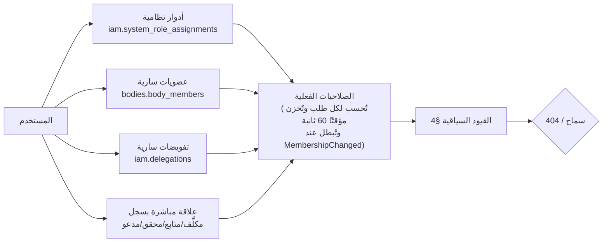

# 06 — نموذج الصلاحيات والأدوار

النموذج هجين: **أدوار** تمنح **صلاحيات** داخل **نطاق** (النظام كله أو جهة بعينها)، ثم **قيود سياقية** (ABAC) تُقيِّد الصلاحية بحالة السجل وتصنيفه وعلاقة المستخدم به. التحقق كله في الخادم (NFR-SEC-08).

## 0. الأدوار المنفذة في المرحلة 1

الأدوار الأولية الاثنا عشر التي حددها المكتب، كما هي في `iam.roles` (الترحيل V005)، ومصفوفة صلاحياتها في `iam.role_permissions`:

| الدور المطلوب | الرمز | النطاق | مصدره |
|---|---|---|---|
| مدير النظام | `system_admin` | النظام | إسناد نظامي |
| مسؤول المجالس واللجان | `governance_officer` | كل الجهات | إسناد نظامي |
| رئيس المجلس أو اللجنة | `chair` | الجهة | العضوية |
| نائب الرئيس | `vice_chair` | الجهة | العضوية |
| أمين السر | `secretary` | الجهة | العضوية |
| عضو | `member` | الجهة | العضوية |
| مدعو أو مراقب | `observer` | الجهة | العضوية (يجمع المدعو والمراقب والمستشار في هذه المرحلة) |
| مسؤول تنفيذ المهام | `task_executor` | المهمة | العلاقة: المكلَّف بالمهمة |
| مسؤول متابعة | `task_follow_up` | المهمة | العلاقة: المسؤول المتابِع أو مدير الإدارة المكلفة |
| ممثل جهة خارجية | `external_representative` | مهام جهته فقط | إسناد نظامي + ربط الحساب بالجهة + `EXTERNAL_PORTAL_ENABLED` |
| الإدارة العليا | `executive` | كل الجهات، اطلاع فقط | إسناد نظامي |
| مدقق مخول | `auditor` | سجل التدقيق والإعدادات، اطلاع فقط | إسناد نظامي |

التقييم في `Ccms.Modules.Iam/AccessService.cs` لكل طلب وفي الخادم: النطاقات المنفذة هي النظام، والجهة، والمهمة، والمستند (مشتق من مالكه)، والسجل (اجتماع، محضر، قرار يُرد إلى جهته). ما خارج نطاق الاطلاع يعيد 404، وما داخله دون الصلاحية يعيد 403. القيود السياقية في §4 المنفذة الآن: سريان العضوية، وفصل المهام في الإقرار؛ وقيد التصنيف مقابل التصريح مؤجل إلى المرحلة 2.

### 0.1 إضافات المرحلة 2

- دور جهة جديد `alternate` (عضو بديل): يطّلع على الجهة والاجتماعات والمحاضر والقرارات والمستندات، ولا يصوّت إلا بحلوله محل أصيله الغائب في النصاب.
- صلاحيات جديدة في `iam.permissions` (V008):

| الصلاحية | تُمنح لـ | تُستخدم في |
|---|---|---|
| body.lifecycle.manage | governance_officer | تفعيل الجهة وتعليقها واستئنافها وتجديدها وتمديدها وإنهاؤها وأرشفتها |
| body.policy.manage | governance_officer | إصدار سياسة جديدة للجهة |
| body.delegate | governance_officer، chair، member | التفويض بصلاحيات الرئيس والإنابة في الحضور |
| meeting.invite | chair، secretary | إرسال الدعوات والتذكير ودعوة الضيوف |
| meeting.attendance | chair، vice_chair، secretary | تسجيل الحضور وفحص النصاب والافتتاح والإغلاق |

- علاقة السجل `IRecordRelationProvider`: المدعو ضيفًا لاجتماع يحصل على الاطلاع عليه بعد إرسال دعوته فقط.
- التفويض (§6) منفذ: `chair_authority` الساري يمنح المفوَّض أدوار الرئيس في الجهة خلال مدته، ويُلغى آليًا بإنهاء عضوية المفوِّض أو تغيير الرئيس أو إنهاء الجهة. `attendance_proxy` يُقبل في تسجيل الحضور فقط إن أجازته سياسة الجهة وضمن حدها.

### 0.2 إضافات المرحلة 3

صلاحيات جديدة في `iam.permissions` (V009)؛ ودورة اعتماد المحضر نفسها تختلف لكل جهة حسب سياستها (08، 19 §1):

| الصلاحية | تُمنح لـ | تُستخدم في |
|---|---|---|
| minutes.comment | chair، vice_chair، secretary، member، alternate | الملاحظات على المحضر أثناء المراجعة |
| minutes.review_secretary | secretary | إقرار مرحلة «مراجعة أمين السر» |
| minutes.templates.manage | system_admin، governance_officer | قوالب المحاضر |
| vote.cast | chair، vice_chair، member، alternate | الإدلاء بالصوت (بالأصالة أو بالإنابة أو بديلًا عن أصيل غائب)؛ الأهلية الفعلية تُفحص وقت التصويت |
| vote.manage | chair، secretary | فتح التصويت وإغلاقه وسحبه وتسجيل رفع الأيدي |
| vote.view_individual | chair، secretary، governance_officer، auditor | الاطلاع على الأصوات الفردية في التصويت العلني؛ السري لا تُحفظ فيه الأصوات الفردية أصلًا |

- مُنحت صلاحية الإقرار (minutes.sign) للرئيس (حين تشترط السياسة توقيعه) و`minutes.view` لمسؤول المجالس.
- الاعتماد النهائي: `minutes.approve` (الرئيس أو المفوَّض بـ `chair_authority`)، مع فصل المهام: لا يعتمد من أعدّ الإصدار. في مسار الاعتماد الخارجي يسجّل أمين السر (`minutes.edit`) اعتماد صاحب الصلاحية بمرجع ودليل.

## 1. مصادر الصلاحية

## 2. الأدوار

### 2.1 أدوار نظامية (نطاقها النظام كله)

| الرمز | الدور | الوصف |
|---|---|---|
| `system_admin` | مدير النظام | المستخدمون والأدوار النظامية، والإعدادات، والمفاتيح، والقوالب، والموصلات، وصحة النظام. **لا يرى محتوى المحاضر والمذكرات** ما لم يكن عضوًا |
| `governance_officer` | مسؤول شؤون المجالس | ينشئ الجهات ويدير حالاتها وسياساتها وعضوياتها، ويرى بيانات التشكيل لكل الجهات وتقارير الالتزام، ولا يرى محتوى المحاضر إلا بعضوية |
| `executive` | الإدارة العليا | لوحة الإدارة العليا والتقارير المجمعة لكل الجهات حتى تصريحه، والاطلاع على القرارات الصادرة |
| `auditor` | المراجع | قراءة سجل التدقيق وسجل الاطلاع وتصديرهما، وتقارير الامتثال؛ لا يرى المحتوى |
| `employee` | موظف | الافتراضي لكل مستخدم: لوحتي، ومهامي، والدليل |

### 2.2 أدوار الجهة (نطاقها جهة واحدة، من العضوية)

| الرمز | الدور | يصوّت | يُحتسب في النصاب |
|---|---|---|---|
| `chair` | الرئيس | نعم | نعم |
| `vice_chair` | نائب الرئيس | نعم | نعم |
| `secretary` | أمين السر | لا (ما لم تكن له عضوية مصوتة منفصلة — غير مسموح بالجمع في الجهة نفسها) | لا |
| `assistant_secretary` | مساعد أمين السر | لا | لا |
| `member` | عضو | نعم (`is_voting`) | نعم إن كان مصوتًا |
| `advisor` | مستشار | لا | لا |
| `observer` | مراقب | لا | لا |

### 2.3 أدوار مشتقة من علاقة بسجل

| الدور | يُشتق من | النطاق |
|---|---|---|
| `invitee` | `meetings.invitations` (ضيف) | الاجتماع، أو بند واحد إن حُدد |
| `task_assignee` | `tasks.tasks.assignee_user_id` | المهمة |
| `task_accountable` | `tasks.tasks.accountable_user_id`، أو مدير الوحدة المكلَّفة | المهمة |
| `task_verifier` | `tasks.tasks.verifier_user_id` | المهمة |
| `delegate` | `iam.delegations` | حسب نطاق التفويض |

## 3. الصلاحيات ومصفوفة المنح

ترميز الصلاحية `{مورد}.{فعل}`. الرموز: ✔ مسموح، ◐ مسموح بقيد (انظر العمود الأخير)، — غير مسموح.

| الصلاحية | system_admin | governance_officer | executive | chair | vice_chair | secretary | member | advisor/observer | invitee | قيد |
|---|---|---|---|---|---|---|---|---|---|---|
| `bodies.create` | — | ✔ | — | — | — | — | — | — | — | |
| `bodies.update` | — | ✔ | — | — | — | ◐ | — | — | — | أمين السر: الاختصاصات والقالب فقط |
| `bodies.change_status` | — | ✔ | — | — | — | — | — | — | — | |
| `bodies.manage_members` | — | ✔ | — | — | — | ◐ | — | — | — | أمين السر يقترح، والمسؤول يعتمد |
| `bodies.manage_policy` | — | ✔ | — | ◐ | — | — | — | — | — | الرئيس يعتمد إصدار السياسة إن اشتُرط |
| `bodies.view` | — | ✔ | ✔ | ✔ | ✔ | ✔ | ✔ | ✔ | — | |
| `meetings.create` / `meetings.update` | — | — | — | ✔ | ◐ | ✔ | — | — | — | النائب عند غياب الرئيس أو بتفويض |
| `meetings.publish_agenda` | — | — | — | ✔ | ◐ | ✔ | — | — | — | |
| `meetings.cancel` / `meetings.postpone` | — | — | — | ✔ | ◐ | ◐ | — | — | — | أمين السر بموافقة الرئيس المسجلة |
| `meetings.view` | — | — | ◐ | ✔ | ✔ | ✔ | ✔ | ✔ | ◐ | التنفيذي: البيانات الوصفية؛ المدعو: بنوده |
| `agenda.view_materials` | — | — | — | ✔ | ✔ | ✔ | ✔ | ✔ | ◐ | بعد نشر الجدول؛ المدعو: بنده |
| `attendance.record` | — | — | — | ✔ | — | ✔ | — | — | — | |
| `attendance.self_check_in` | — | — | — | ✔ | ✔ | — | ✔ | ✔ | ✔ | |
| `quorum.override` | — | — | — | ◐ | — | — | — | — | — | فقط إن أجازته السياسة، بسبب |
| `conflict.declare` | — | — | — | ✔ | ✔ | ◐ | ✔ | — | — | أمين السر يسجل نيابة بطلب العضو |
| `deliberation.write_notes` | — | — | — | — | — | ✔ | — | — | — | |
| `motions.manage` | — | — | — | ✔ | ◐ | ✔ | — | — | — | |
| `votes.open_close` | — | — | — | ✔ | ◐ | ◐ | — | — | — | أمين السر يفتح بتوجيه الرئيس المسجل |
| `votes.cast` | — | — | — | ◐ | ◐ | — | ◐ | — | — | §4: أحقية التصويت |
| `votes.record_show_of_hands` | — | — | — | — | — | ✔ | — | — | — | |
| `circulations.manage` | — | — | — | ✔ | — | ✔ | — | — | — | |
| `minutes.edit` | — | — | — | — | — | ✔ | — | — | — | ومساعد أمين السر |
| `minutes.submit_for_review` | — | — | — | — | — | ✔ | — | — | — | |
| `minutes.comment` | — | — | — | ✔ | ✔ | — | ◐ | ◐ | — | الحاضرون فقط |
| `minutes.sign_off` | — | — | — | — | ◐ | — | ◐ | — | — | الحاضرون المصوتون عدا الرئيس، حسب السياسة |
| `minutes.record_wet_signature` | — | — | — | — | — | ✔ | — | — | — | برفع دليل |
| `minutes.approve` / `minutes.return` | — | — | — | ✔ | ◐ | — | — | — | — | النائب بتفويض `chair_authority` ساري |
| `minutes.view` | — | — | — | ✔ | ✔ | ✔ | ✔ | ✔ | — | |
| `minutes.amend` | — | — | — | ✔ | — | ✔ | — | — | — | يبدأ محضر تصحيح |
| `resolutions.view` | — | — | ✔ | ✔ | ✔ | ✔ | ✔ | ✔ | — | التنفيذي: الصادرة فقط |
| `resolutions.change_status` | — | — | — | ✔ | — | ◐ | — | — | — | أمين السر: «قيد التنفيذ/منفذ» |
| `resolutions.cancel_supersede` | — | — | — | ✔ | — | — | — | — | — | |
| `tasks.manage` | — | — | — | ✔ | ◐ | ✔ | — | — | — | إنشاء/إسناد/إعادة إسناد/إلغاء |
| `tasks.view_body` | — | — | ◐ | ✔ | ✔ | ✔ | ✔ | ◐ | — | التنفيذي: مجمعة؛ المراقب حسب السياسة |
| `tasks.update_progress` | — | — | — | — | — | ✔ | — | — | — | + المكلَّف والمتابِع (§2.3) |
| `tasks.verify` | — | — | — | ✔ | — | ✔ | — | — | — | + المحقق المعيّن |
| `tasks.decide_extension` | — | — | — | ◐ | — | ◐ | — | — | — | حسب `extension_approver` |
| `reports.executive` | — | — | ✔ | — | — | — | — | — | — | |
| `reports.body` | — | ✔ | ✔ | ✔ | ✔ | ✔ | ◐ | — | — | العضو: تقرير الحضور والقرارات |
| `search.query` | — | — | ✔ | ✔ | ✔ | ✔ | ✔ | ✔ | — | النتائج ضمن النطاق |
| `admin.users` / `admin.roles` | ✔ | — | — | — | — | — | — | — | — | |
| `admin.feature_flags` / `admin.settings` / `admin.templates` | ✔ | — | — | — | — | — | — | — | — | |
| `admin.body_feature_overrides` | ✔ | ✔ | — | — | — | — | — | — | — | تجاوزات المفاتيح على مستوى الجهة |
| `admin.outbox` / `admin.health` | ✔ | — | — | — | — | — | — | — | — | |
| `audit.read` / `audit.export` | — | — | — | — | — | — | — | — | — | للمراجع `auditor` فقط |
| `ai.use` | — | — | — | ◐ | ◐ | ◐ | ◐ | — | — | حسب القدرة (10 §3) والمفتاح |
| `esign.sign` | — | — | — | ◐ | ◐ | — | ◐ | — | — | ضمن `minutes.sign_off` أو توقيع الرئيس |

صلاحيات العلاقة المباشرة (§2.3):

| الصلاحية | task_assignee | task_accountable | task_verifier |
|---|---|---|---|
| `tasks.view_own` (المهمة + نص القرار ورقمه + اسم الجهة) | ✔ | ✔ | ✔ |
| `tasks.update_progress` / رفع الأدلة | ✔ | ✔ | — |
| `tasks.submit_for_verification` | ✔ | ✔ | — |
| `tasks.request_extension` | ✔ | ✔ | — |
| `tasks.verify` / `tasks.return` | — | — | ✔ |

## 4. القيود السياقية (ABAC)

| القيد | القاعدة |
|---|---|
| سريان العضوية | الصلاحية تسري بين `start_date` و`end_date`؛ للاجتماعات يُعتمد تاريخ الاجتماع لا تاريخ اليوم في: الدعوة، والحضور، والتصويت، والإقرار |
| أعضاء سابقون | يحتفظ العضو السابق بالاطلاع على محاضر الاجتماعات التي حضرها فقط (قابل للتهيئة `bodies.former_member_access`) |
| التصنيف | `record.classification ≤ user.clearance`؛ البند المصنف أعلى من الجهة يُخفى عمن لا يملك التصريح حتى لو كان عضوًا، ويُعرض «بند مقيد» |
| أحقية التصويت | عضو بدور مصوت، سارية عضويته في تاريخ الاجتماع، حاضر (أو منيب ساري)، غير مُفصِح عن تعارض في البند، ولم يصوت بعد |
| تعارض المصالح | المُفصِح لا يرى نتائج التصويت التفصيلية للبند قبل الإغلاق، ولا يصوت، ولا يُحتسب في نصاب البند |
| فصل المهام | من أنشأ إصدار المحضر لا يعتمده؛ من صوّت على مقترح لا يسجل أصوات رفع الأيدي له؛ المكلَّف لا يتحقق من مهمته؛ مقدّم طلب التمديد لا يبت فيه |
| حالة السجل | لا تعديل على محضر في حالة غير `draft`؛ لا تعديل على سجل مؤرشف؛ لا تصويت على مقترح مغلق |
| حد الذكاء الاصطناعي | `ai.max_classification` يمنع إرسال سجل أعلى تصنيفًا إلى النموذج (10 §6) |

## 5. قاعدة «المكلَّف يرى مهمته فقط»

المكلَّف من خارج الجهة يحصل على عرض مقيد `TaskAssigneeView`: عنوان المهمة ووصفها، ونص القرار المرتبط ورقمه وتاريخه، واسم الجهة، والموعد، والخط الزمني لمهمته، ومرفقات المهمة. لا يحصل على المحضر ولا جدول الأعمال ولا بقية القرارات، حتى لو أُرسل له رابطها (404).

## 6. التفويض والإنابة

| النوع | من يفوّض | لمن | الأثر | القيود |
|---|---|---|---|---|
| `chair_authority` | الرئيس | نائب الرئيس أو عضو مصوت | صلاحيات الرئيس (الاعتماد، الإعادة، فتح التصويت، إدارة الاجتماع) خلال المدة | مدة محددة؛ يُسجَّل كل إجراء «نيابة عن»؛ لا يفوّض المفوَّض غيره |
| `attendance_proxy` | عضو مصوت | عضو مصوت آخر في الجهة نفسها | يُحتسب حضورًا ويصوت عنه، إن أجازته السياسة | حد أقصى `max_proxies_per_member`؛ لاجتماع أو مدة؛ لا يُقر المحضر نيابة عنه |

غياب الرئيس دون تفويض: نائب الرئيس يملك صلاحيات إدارة الاجتماع آليًا، لكن **الاعتماد يتطلب تفويضًا** صريحًا (ASM-09).

## 7. ما يراه مدير النظام

مدير النظام يدير المنصة ولا يُعد مطّلعًا على محتوى الحوكمة. يرى: أسماء الجهات وحالاتها وأعداد السجلات، وصندوق الصادر (بلا نصوص للمصنف ≥ `secret`)، وسجلات الموصلات. لا يرى نصوص المحاضر والمذكرات والقرارات غير المنشورة. الوصول الطارئ لبيانات جهة يتطلب إسناد عضوية مؤقتة يوثقها مسؤول شؤون المجالس، ويظهر في التدقيق.
