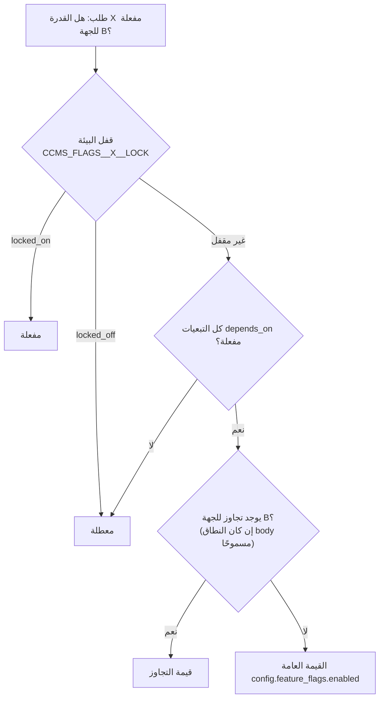

# 07 — الإعدادات المركزية (Feature Flags)

## 0. المفاتيح المنفذة في المرحلة 1 (المرجع الملزم للتنفيذ)

اعتمد المكتب أسماء المفاتيح التالية؛ هي المخزنة في `config.feature_flags` (الترحيلان V005 وV007). الجدول في §3 يبقى مرجع التصميم لما بعد المرحلة 1، ويقابله هذا الجدول:

| المفتاح المنفذ | النوع | المفتاح الأعلى | يقابل في التصميم | الموصل |
|---|---|---|---|---|
| `AI_ENABLED` | منطقي | — | `module.ai` | ai |
| `AI_MINUTES_SUMMARY_ENABLED` | منطقي | AI_ENABLED | `ai.memo_summary` | ai |
| `AI_DECISION_EXTRACTION_ENABLED` | منطقي | AI_ENABLED | `ai.action_extraction` (القرارات) | ai |
| `AI_TASK_EXTRACTION_ENABLED` | منطقي | AI_ENABLED | `ai.action_extraction` (المهام) | ai |
| `AI_SMART_SEARCH_ENABLED` | منطقي | AI_ENABLED | `ai.assistant_qa` + `ai.semantic_index` | ai |
| `AI_AUDIO_TRANSCRIPTION_ENABLED` | منطقي | AI_ENABLED | `ai.transcription` | ai |
| `E_SIGNATURE_ENABLED` | منطقي | — | `module.esignature` | esign |
| `E_SIGNATURE_PROVIDER` | قائمة: none, sandbox, national_provider | E_SIGNATURE_ENABLED | `esign.provider` | esign |
| `E_SIGNATURE_METHOD` | قائمة: remote_certificate, otp_confirmation | E_SIGNATURE_ENABLED | — | esign |
| `E_SIGNATURE_MEMBER_REQUIRED` | منطقي | E_SIGNATURE_ENABLED | `esign.attendee_signing` | esign |
| `E_SIGNATURE_CHAIR_REQUIRED` | منطقي | E_SIGNATURE_ENABLED | `esign.chair_signing` | esign |
| `E_SIGNATURE_SECRETARY_REQUIRED` | منطقي | E_SIGNATURE_ENABLED | — | esign |
| `E_SIGNATURE_SEQUENTIAL` | منطقي | E_SIGNATURE_ENABLED | — | esign |
| `E_SIGNATURE_PDF_OUTPUT` | منطقي | E_SIGNATURE_ENABLED | — | esign |
| `E_SIGNATURE_REAUTH_REQUIRED` | منطقي | E_SIGNATURE_ENABLED | — | esign |
| `EXTERNAL_PORTAL_ENABLED` | منطقي | — | (جديد) بوابة ممثلي الجهات الخارجية | — |
| `EMAIL_INTEGRATION_ENABLED` | منطقي | — | `integrations.graph_mail` / `integrations.smtp` | email |
| `CORRESPONDENCE_INTEGRATION_ENABLED` | منطقي | — | `integrations.qemam` | correspondence |
| `SSO_ENABLED` | منطقي | — | (جديد) الدخول الموحد عبر Entra ID | sso |

قواعد مطبقة ومختبرة في المرحلة 1: القيمة الفعلية = قيمة المفتاح ∧ المفتاح الأعلى، ويتقدم عليهما قفل البيئة `FeatureManagement:Locks:<KEY>`؛ حالة الإعداد مستقلة عن حالة اتصال المزوّد (`config.connector_status`)؛ كل محاولة تغيير تُسجَّل في `config.feature_flag_history` بالنتيجة (`succeeded`, `rejected_validation`, `confirmation_required`, `denied`, `failed`)؛ والتغيير المؤثر في عمليات جارية يتطلب `confirmImpact=true`. تجاوزات المفاتيح على مستوى الجهة (§2) مؤجلة إلى المرحلة 2.

## 1. الأهداف والضمانات

1. تفعيل أي وحدة اختيارية أو قدرة أو موصل وتعطيله من لوحة الإدارة دون نشر جديد ولا إعادة تشغيل.
2. **التعطيل لا يحذف بيانات أبدًا** ولا يغير هيكل قاعدة البيانات: الجداول والترحيلات موجودة دائمًا (ADR-005).
3. **التعطيل لا يكسر عملًا أساسيًا جاريًا**: لكل منفذ بديل افتراضي (03 §5.5)، ولكل حالة معلقة على وحدة معطلة مسار متابعة بديل (§6).
4. كل تغيير له سبب إلزامي، ويُسجَّل في التدقيق وفي سجل تاريخ المفاتيح، وتسبقه شاشة «أثر التغيير».
5. ما هو خطِر أمنيًا يمكن قفله من بيئة الخادم فلا تستطيع الواجهة تجاوزه.

## 2. التقييم: من يفوز؟



قواعد:
- **قفل البيئة** يتقدم على كل شيء. يُستخدم في الإنتاج مثلًا لقفل `module.ai=locked_off` حتى يكتمل تقييم الأمن، فيظهر المفتاح في اللوحة معطلًا وغير قابل للتغيير مع سبب «مقفل من إعدادات الخادم».
- **التبعيات** تُقيَّم تعاوديًا: `ai.minutes_draft` لا يعمل إن كان `module.ai` معطلًا مهما كانت قيمته.
- **تجاوز الجهة** يسمح بتعطيل قدرة لجهة بعينها (مثل منع الذكاء الاصطناعي في لجنة سرية) أو تفعيلها تجريبيًا لجهة واحدة. التجاوز لا يفعّل قدرة تبعياتها العامة معطلة.
- القيمة تُقرأ من ذاكرة مؤقتة لمدة 30 ثانية، وتُبطل فورًا في النسخة التي غيّرت القيمة، وعبر حدث `FeatureFlagChanged` في بقية النسخ.

## 3. سجل المفاتيح

| المفتاح | النوع | الافتراضي | النطاقات | يعتمد على | الوصف |
|---|---|---|---|---|---|
| `module.esignature` | module | معطل | global | — | وحدة التوقيع الإلكتروني (09) |
| `esign.attendee_signing` | capability | معطل | global, body | `module.esignature` | توقيع الحاضرين إلكترونيًا على المحضر |
| `esign.chair_signing` | capability | معطل | global, body | `module.esignature` | توقيع الرئيس الإلكتروني على النسخة المعتمدة |
| `module.ai` | module | معطل | global | — | وحدة الذكاء الاصطناعي (10) |
| `ai.memo_summary` | capability | معطل | global, body | `module.ai` | تلخيص مذكرات البنود |
| `ai.minutes_draft` | capability | معطل | global, body | `module.ai` | مسودة محضر آلية |
| `ai.action_extraction` | capability | معطل | global, body | `module.ai` | اقتراح القرارات والمهام |
| `ai.assistant_qa` | capability | معطل | global, body | `module.ai`, `ai.semantic_index` | المساعد على الأرشيف |
| `ai.semantic_index` | capability | معطل | global | `module.ai` | الفهرسة الدلالية (pgvector) |
| `ai.transcription` | capability | معطل | global, body | `module.ai` | التفريغ الصوتي (W) |
| `ai.translation` | capability | معطل | global, body | `module.ai` | الترجمة عربي ↔ إنجليزي |
| `integrations.graph_mail` | connector | معطل | global | — | البريد عبر Microsoft Graph |
| `integrations.smtp` | connector | معطل | global | — | البريد عبر SMTP داخلي (بديل) |
| `integrations.graph_calendar` | connector | معطل | global | — | أحداث التقويم والردود |
| `integrations.entra_directory` | connector | معطل | global | — | مزامنة الموظفين من Entra ID |
| `integrations.erp_directory` | connector | معطل | global | — | مزامنة الهيكل من ERP |
| `integrations.qemam` | connector | معطل | global, body | — | خطابات المهام الخارجية عبر قمم |
| `integrations.sms` | connector | معطل | global | — | الرسائل النصية |
| `integrations.sharepoint_storage` | connector | معطل | global | — | تخزين المستندات في SharePoint |
| `documents.malware_scan` | capability | معطل | global | — | فحص المرفقات |
| `voting.electronic` | capability | مفعّل | global, body | — | تصويت الأعضاء من أجهزتهم |
| `voting.secret_ballot` | capability | مفعّل | global, body | — | الاقتراع السري |
| `voting.circulation` | capability | مفعّل | global, body | — | القرار بالتمرير (مع `allow_circulation` في السياسة) |
| `meetings.agenda_requests` | capability | معطل | global, body | — | طلبات إدراج البنود (FR-MTG-04) |
| `meetings.self_check_in` | capability | معطل | global, body | — | تسجيل الحضور الذاتي (FR-ATT-07) |
| `tasks.subtasks` | capability | مفعّل | global | — | المهام الفرعية |
| `documents.watermark` | capability | مفعّل | global | — | العلامة المائية على المصنف |
| `search.attachment_text` | capability | معطل | global | — | فهرسة نص المرفقات |
| `ui.english` | capability | مفعّل | global | — | واجهة إنجليزية |

> التحقق: كل مفتاح في هذا الجدول يقابله صف في `config.feature_flags` يُزرع بالترحيل، واختبار آلي يمنع استخدام مفتاح في الشيفرة غير موجود هنا (TS-21).

**ليست مفاتيح:** الوحدات الأساسية (المحاضر، المهام، النصاب...) لا تُعطَّل. سلوكها يُضبط بسياسة الجهة (05 §3.2) لا بالمفاتيح.

## 4. الإعدادات غير المنطقية (Settings)

قيم مركزية في `config.settings`، تُعدَّل من لوحة الإدارة بالسبب والتدقيق نفسه.

| المفتاح | النوع | الافتراضي | الوصف |
|---|---|---|---|
| `esign.provider` | text | `none` | رمز مزوّد التوقيع المسجل (`none`, `sandbox`, أو مزوّد معتمد بعد التعاقد) |
| `esign.request_expiry_hours` | int | 72 | صلاحية طلب التوقيع |
| `ai.provider` | text | `openai_compatible` | نوع المزوّد |
| `ai.base_url` | text | — | نقطة النهاية (يجب أن يكون مضيفها ضمن `ai.allowed_hosts`) |
| `ai.model` / `ai.embedding_model` | text | — | — |
| `ai.api_key` | secret | — | مشفر |
| `ai.allowed_hosts` | text[] | `[]` | قائمة المضيفين المسموح الإرسال إليهم؛ **مقفلة من البيئة في الإنتاج** |
| `ai.max_classification` | text | `restricted` | أعلى تصنيف يجوز إرساله للنموذج |
| `ai.daily_quota_per_user` | int | 50 | حد الطلبات اليومي |
| `ai.timeout_seconds` | int | 120 | — |
| `notify.sender_address` | text | — | الصندوق الخدمي المرسل |
| `notify.reminder_days_before` | int | 3 | افتراضي سياسة التصعيد |
| `notify.max_attempts` | int | 8 | — |
| `meetings.agenda_lead_days` | int | 3 | مهلة نشر الجدول قبل الاجتماع (تنبيه لا منع) |
| `meetings.quorum_forecast_hours` | int | 48 | توقيت تنبيه توقع النصاب |
| `bodies.former_member_access` | text | `attended_only` | `none`, `attended_only`, `all_during_term` |
| `documents.allowed_types` | text[] | pdf, docx, xlsx, pptx, png, jpg | — |
| `documents.max_size_mb` | int | 50 | — |
| `session.idle_minutes` / `session.max_hours` | int | 30 / 10 | — |
| `calendar.timezone` | text | `Asia/Riyadh` | — |
| `calendar.weekend_days` | int[] | [5, 6] | الجمعة والسبت |
| `numbering.meeting_format` / `numbering.resolution_format` / `numbering.task_format` | text | 08 §7 | قوالب الترقيم |

## 5. نموذج البرمجة

```csharp
public interface IFeatureGate
{
    ValueTask<bool> IsEnabledAsync(string key, Guid? bodyId = null, CancellationToken ct = default);
    ValueTask<FeatureSnapshot> SnapshotAsync(Guid? bodyId, CancellationToken ct = default);
}

// نقطة نهاية لوحدة اختيارية
group.MapPost("/minutes/{id}/draft", DraftMinutes)
     .RequireFeature("ai.minutes_draft", bodyFrom: RouteBody.FromMinutes);   // 404 feature-disabled إن كانت معطلة

// اختيار منفذ وقت الطلب
services.AddScoped<ISignOffChannelResolver, SignOffChannelResolver>();   // يعيد AttestationChannel إن كانت esign.attendee_signing معطلة
```

الواجهة تستدعي `GET /api/v1/features?bodyId=` وتخفي العناصر المعطلة، لكن **الإخفاء ليس ضمانًا**؛ الخادم يرفض.

## 6. سلوك التعطيل للحالات الجارية

| عند تعطيل | ما يحدث للحالات الجارية | ما يظهر للمستخدم |
|---|---|---|
| `module.esignature` / `esign.attendee_signing` | طلبات التوقيع الجارية تبقى بحالتها في `sig.signature_requests`، وتتوقف المزامنة. الإقرارات المكتملة إلكترونيًا تبقى صالحة. المحضر بانتظار التوقيعات يعرض لأمين السر: «إعادة طلب الإقرار بالبديل» (إقرار داخلي أو دليل ورقي) لمن لم يوقع | شارة «التوقيع الإلكتروني متوقف» على المحاضر المتأثرة |
| `esign.chair_signing` | الاعتماد يتم بلا توقيع إلكتروني للرئيس؛ PDF يُصدر برمز التحقق الداخلي | — |
| `module.ai` أو أي قدرة | تُلغى المهام في الطابور بحالة `cancelled`؛ الاقتراحات المعلقة تبقى قابلة للعرض للقراءة فقط في سجل الاقتراحات، ولا تُطبَّق | أزرار الذكاء الاصطناعي تختفي؛ ما قُبل سابقًا صار بيانات أساسية لا يتأثر |
| `ai.semantic_index` | التضمينات تبقى ولا تُحدَّث؛ عند إعادة التفعيل تُستكمل الفهرسة للسجلات الأحدث من آخر فهرسة | البحث النصي يعمل كما هو |
| `integrations.graph_mail` | الرسائل الجديدة تُسجَّل `logged`؛ يمكن إعادة إرسالها لاحقًا يدويًا من الصادر | تنبيه لمدير النظام |
| `integrations.graph_calendar` | الاجتماعات القائمة تحتفظ بمعرّفات الأحداث في `integ.external_refs`؛ التحديثات الجديدة تُرسل كملف .ics | — |
| `integrations.qemam` | المهام الخارجية الجديدة تطلب إدخال رقم الخطاب يدويًا | حقل يدوي يظهر |
| `integrations.sharepoint_storage` | الملفات المخزنة هناك تبقى مقروءة **ما دام الموصل متصلًا**؛ لذلك التعطيل يتطلب أولًا تنفيذ أداة نقل الملفات إلى المخزن المحلي، وشاشة الأثر تمنع التعطيل قبلها | — |
| `voting.electronic` | المقترحات المفتوحة إلكترونيًا تبقى مفتوحة حتى إغلاقها؛ الجديدة برفع الأيدي | — |
| `voting.circulation` | التمريرات المفتوحة تكمل دورتها؛ لا تمرير جديد | — |

## 7. شاشة «أثر التغيير»

قبل تأكيد أي تعطيل تُحسب وتعرض: عدد طلبات التوقيع المعلقة، والمحاضر في `pending_signoffs` بطريقة إلكترونية، ومهام الذكاء الاصطناعي في الطابور والاقتراحات المعلقة، ورسائل الصادر المعلقة للموصل، والمستندات المخزنة لدى الموصل. تُحفظ في `config.feature_flag_history.impact_summary`.

## 8. التدقيق والصلاحيات

- تغيير المفتاح العام: `admin.feature_flags` (مدير النظام).
- تجاوز على مستوى جهة: `admin.body_feature_overrides` (مدير النظام أو مسؤول شؤون المجالس).
- كل تغيير: حدث تدقيق `config.flag_changed` + صف في `config.feature_flag_history` + إشعار لمديري النظام.
