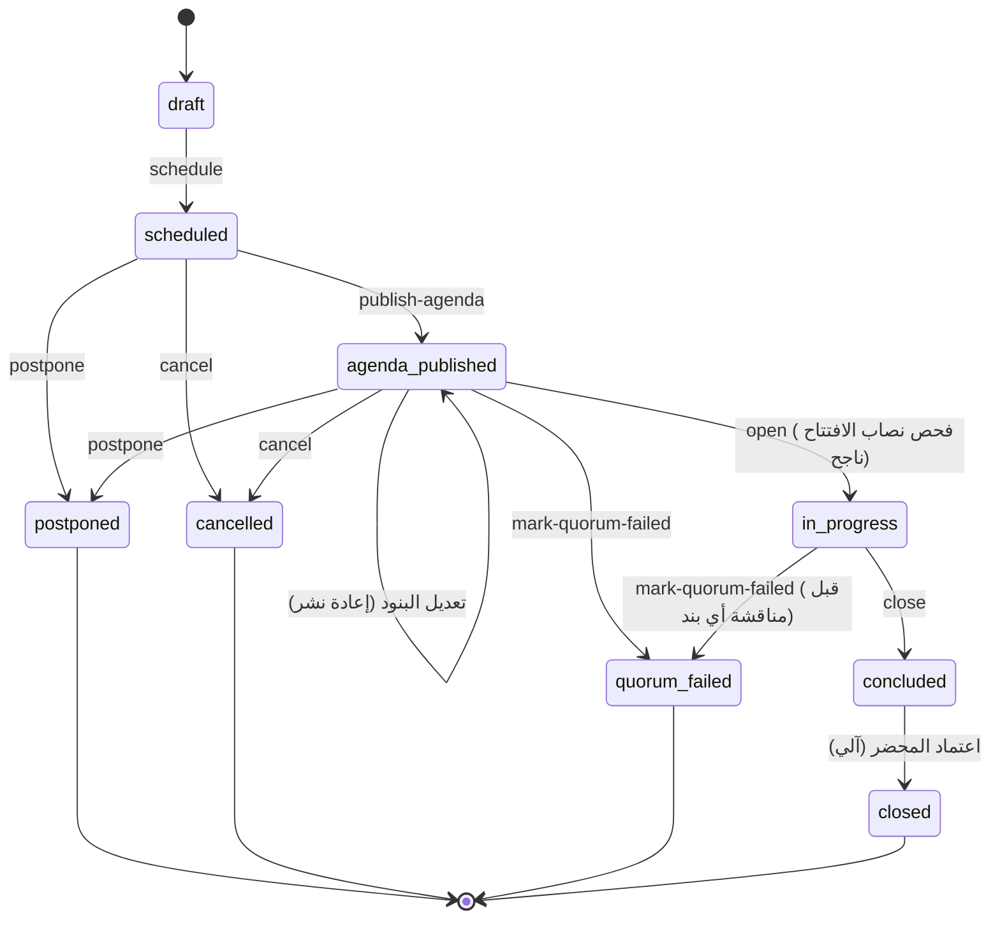
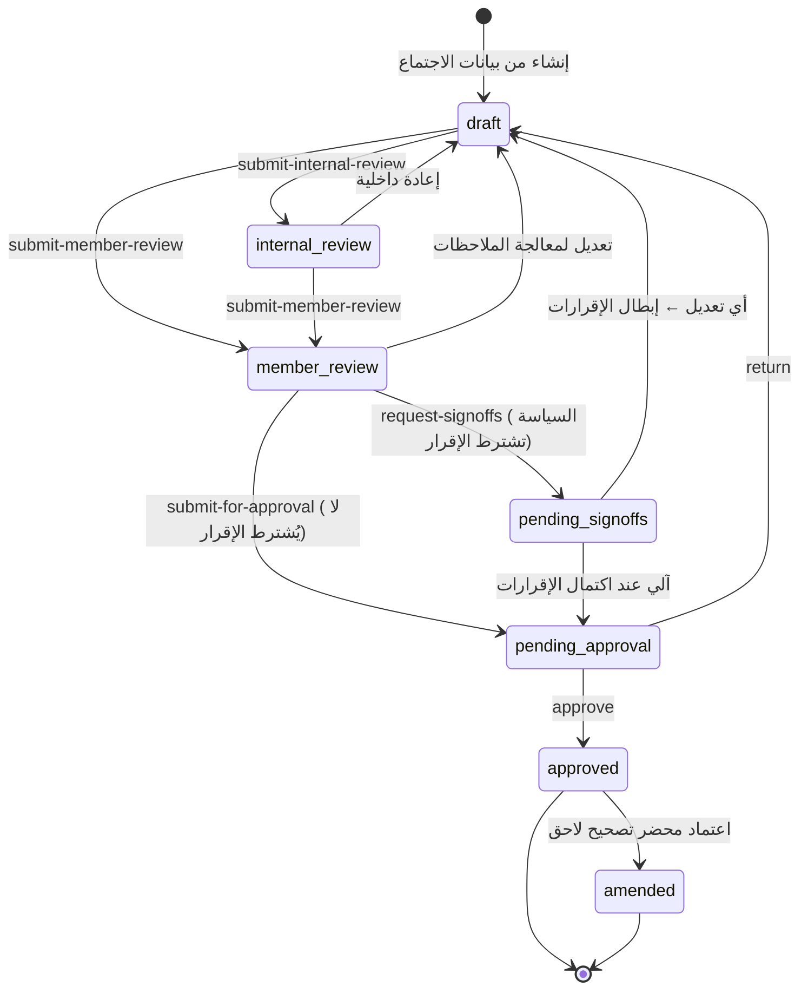
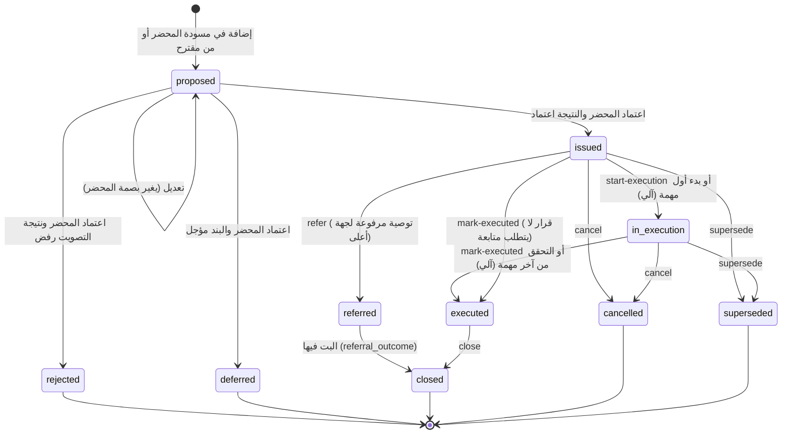
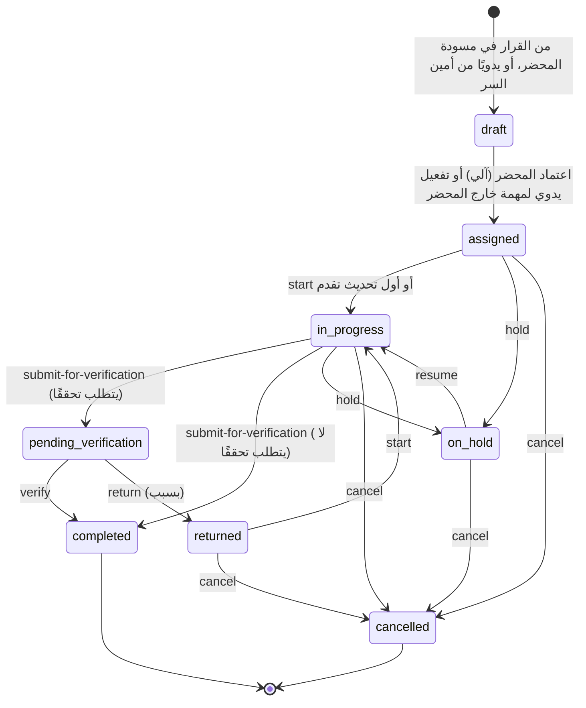
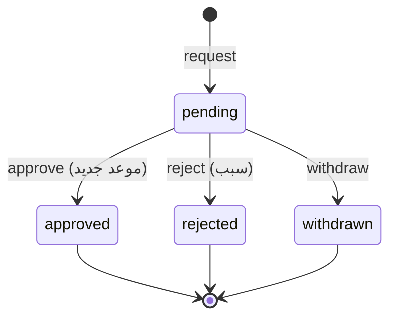
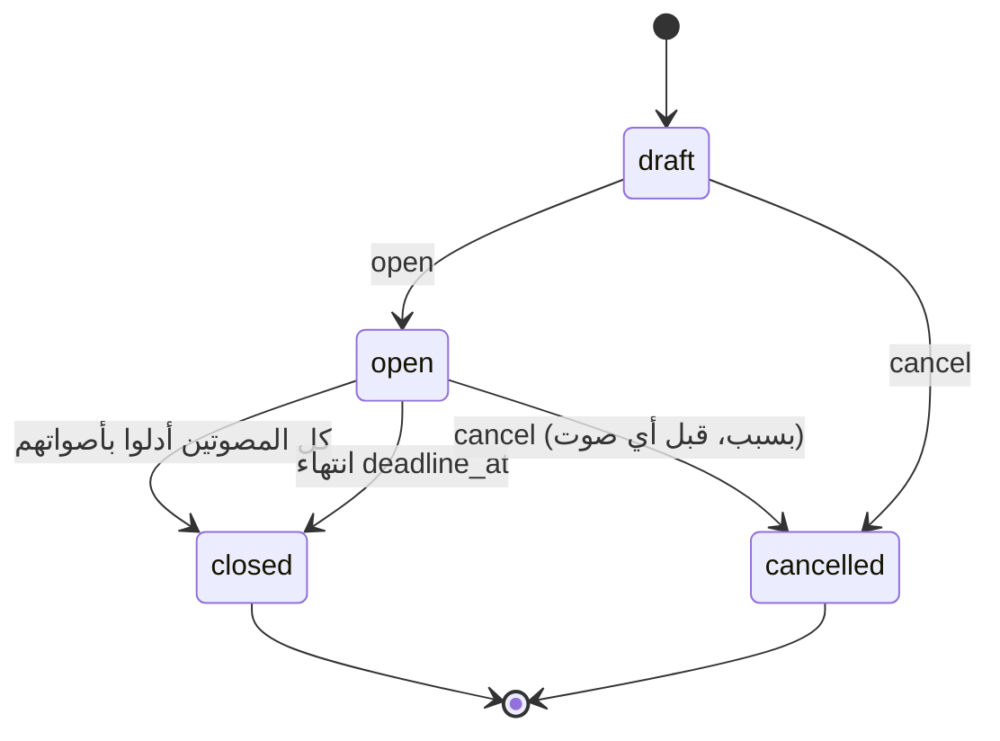

# 08 — دورة الاجتماع والمحضر والقرارات والمهام

هذه الوثيقة هي **المرجع الملزم للحالات والانتقالات**؛ القيم هنا هي القيم المخزنة في أعمدة `status` في 05، وأسماء الانتقالات هي أفعال الواجهات في 11. أي انتقال غير مذكور يُرفض بـ `invalid-transition`.

## 1. الاجتماع — `meetings.meetings.status`



| الانتقال | الشرط | الأثر |
|---|---|---|
| `schedule` | الجهة `active`؛ الموعد مستقبلي | تثبيت `policy_id` الساري في تاريخ الموعد؛ ترقيم الاجتماع |
| `publish-agenda` | بند واحد على الأقل | إنشاء الدعوات للأعضاء النشطين في تاريخ الاجتماع؛ `AgendaPublished`؛ تنبيه إن كان قبل الموعد بأقل من `meetings.agenda_lead_days` |
| `postpone` | سبب؛ موعد جديد | إنشاء اجتماع جديد `scheduled` بالبنود نفسها مربوط بـ `postponed_to_meeting_id`؛ `MeetingRescheduled` |
| `cancel` | سبب | `MeetingCancelled`؛ البنود تعود قابلة للإدراج في اجتماع لاحق |
| `open` | فحص نصاب `opening` ناجح أو تجاوز مسموح موثق | `opened_at` |
| `mark-quorum-failed` | فحص نصاب فاشل | `QuorumNotMet`؛ عرض إنشاء اجتماع بديل |
| `close` | كل البنود `discussed` أو `deferred` أو `withdrawn`؛ لا مقترح مفتوح | إنشاء مسودة المحضر آليًا (FR-MIN-01) |
| (آلي) → `closed` | `MinutesApproved` | قفل سجلات الحضور والنصاب |

## 2. المحضر — `minutes.minutes.status`



### 2.1 قواعد الإصدارات والبصمة

1. التعديل في `draft` يحفظ المسودة دون إنشاء إصدار.
2. **كل انتقال خارج `draft`** يُنشئ إصدارًا جديدًا غير قابل للتعديل في `minutes.minutes_versions` إن تغيرت البصمة عن آخر إصدار، وإلا يُعاد استخدام الإصدار الأخير.
3. الإقرار والاعتماد يحملان `versionNo` و`contentHash`؛ يُرفضان إن لم يطابقا الإصدار الحالي.
4. العودة إلى `draft` من `pending_signoffs` أو `pending_approval` تُعلّم كل إقرارات الإصدار `invalidated` بسبب «تعديل بعد الإقرار»، وتُرسل للموقِّعين إشعار إعادة الطلب عند الطلب التالي (BRL-06).

### 2.2 الإقرار

- **المطلوبون:** إن كان `signoff_rule.required` صحيحًا: الحاضرون (`present`) من الأعضاء المصوتين في تاريخ الاجتماع **عدا الرئيس وعدا من يعتمد بالتفويض**. المنيب عنه لا يُطلب منه الإقرار، ولا يُقر المنيب نيابة عنه.
- **الطريقة** لكل موقِّع: أول طريقة مسموحة في `signoff_rule.methods` ومتاحة فعليًا (المفتاح مفعّل والمزوّد مهيأ)، ويمكن لأمين السر اختيار البديل لموقِّع بعينه (مثل عضو خارجي بلا حساب نشط) بسبب.
- **التحفظ:** نص حر يُحفظ مع الإقرار ويظهر في PDF (FR-MIN-12) ويُبلَّغ به الرئيس.
- **اكتمال الإقرارات:** حين يملك كل مطلوب إقرارًا `valid` على البصمة الحالية → انتقال آلي إلى `pending_approval` وحدث `MinutesSignOffsCompleted`.
- **مهلة:** تذكير يومي لمن لم يقر بعد انتهاء `minutes_review_days`، وتنبيه لأمين السر؛ لا يُعد الصمت إقرارًا.

### 2.3 حساب البصمة

```
canonical = JSON (مفاتيح مرتبة، بلا مسافات، UTF-8، تطبيع Unicode NFC) لـ:
  { "minutesId", "versionNo",
    "content": <أقسام المحضر>,
    "attendance": [ {userId, status} مرتبة ],
    "resolutions": [ {id, type, textAr, textEn, voteSummary} مرتبة بالمعرّف ],
    "tasks": [ {id, resolutionId, title, assigneeType, assigneeId, accountableUserId, dueDate} مرتبة ] }
content_hash = hex(SHA-256(canonical))
```

أي تغيير في نص قرار أو مكلَّف أو موعد مهمة مسودة يغير البصمة، تمامًا كما في الإصدار 0.5.

### 2.4 الاعتماد

في معاملة واحدة:
1. التحقق: الحالة `pending_approval`، البصمة مطابقة، المعتمد رئيس الجهة أو مفوَّض بـ `chair_authority` ساري، وليس مُعد الإصدار.
2. `minutes_approvals` بقرار `approved`، و`minutes.status = approved`، و`approved_version_id`.
3. RES: إصدار القرارات المعتمدة بالترقيم (§3)، والمرفوضة/المؤجلة تُثبت بحالتها دون رقم.
4. TSK: تفعيل المهام المسودة المرتبطة ← `assigned` بالترقيم.
5. MTG: الاجتماع ← `closed`.
6. Outbox: `MinutesApproved`، `ResolutionIssued`×n، `TaskAssigned`×m.
7. بعد المعاملة (العامل): إصدار PDF وحفظ بصمته ورمز التحقق؛ وطلب توقيع الرئيس الإلكتروني إن فُعّل `esign.chair_signing` وطلبته السياسة. **الاعتماد لا ينتظر PDF ولا التوقيع**.

### 2.5 التصحيح بعد الاعتماد

`POST /minutes/{id}/amendments` يُنشئ محضرًا جديدًا (`amends_minutes_id`) نسخةً من الإصدار المعتمد مع قسم «سبب التصحيح» إلزامي. يمر بالدورة كاملة. عند اعتماده يصبح الأصل `amended` (يبقى مقروءًا مع رابط التصحيح). القرارات المعدلة بالتصحيح تُعامل كـ `supersede` للقرار الأصلي (§3).

## 3. القرار والتوصية — `resolutions.resolutions.status`



| القاعدة | التفصيل |
|---|---|
| الترقيم | يُمنح فقط عند `issued`، بتسلسل سنوي لكل جهة وفق `numbering.resolution_format` (§7) |
| `requires_follow_up = false` | قرار إجرائي (مثل اعتماد محضر سابق)؛ لا يتطلب مهام ويمكن تحويله `executed` مباشرة |
| الإلغاء والاستبدال | من الرئيس بسبب ومرجع (قرار لاحق أو محضر). مهام القرار المفتوحة تُعرض لأمين السر: إلغاء أو نقل للقرار البديل (FR-RES-05) |
| الرفع | توصية `issued` تُرفع إلى `target_body_id` فتُنشئ طلب إدراج بند لدى الجهة الهدف؛ بتها يحدّث `referral_outcome` ∈ `adopted`, `rejected`, `modified` ويغلق التوصية |
| الحالات الآلية | `in_execution` عند أول `TaskStarted` لمهمة مرتبطة؛ `executed` عند التحقق من آخر مهمة غير ملغاة؛ كلاهما قابل للتجاوز اليدوي بسبب |

## 4. المهمة — `tasks.tasks.status`



### 4.1 قواعد

| القاعدة | التفصيل |
|---|---|
| المتأخرة | ليست حالة؛ مؤشر محسوب: `due_date < اليوم` والحالة ∈ {`assigned`, `in_progress`, `returned`}. `pending_verification` لا تُحتسب متأخرة على المكلَّف بل على المحقق (مؤشر مستقل بعد 3 أيام عمل) |
| `on_hold` | يوقف ساعة التصعيد؛ يتطلب سببًا؛ الإيقاف لا يغير الموعد تلقائيًا |
| إعادة الإسناد | تُبقي الحالة، وتُنشئ `task_updates` من نوع `reassignment`، وتُعيد مستوى التصعيد إلى 0 إن مُدد الموعد |
| الأدلة | `submit-for-verification` يتطلب ملاحظة إنجاز، ودليلًا مرفقًا إن نصت السياسة (`evidence_required`) |
| الإلغاء | سبب إلزامي؛ تُستبعد من نسب الإنجاز |
| المهام الفرعية | الأم لا تنتقل إلى `pending_verification` أو `completed` قبل اكتمال أو إلغاء كل الفرعيات (FR-TSK-11) |

### 4.2 التمديد


الموافقة تحدّث `due_date` وتُبقي `original_due_date`، وتُسجَّل في الخط الزمني، وتعيد ضبط مستوى التصعيد. طلب واحد معلق لكل مهمة. صاحب القرار حسب `extension_approver` في السياسة.

### 4.3 التذكير والتصعيد

`escalation_rule` في سياسة الجهة (الافتراضي أدناه يطابق سلوك الإصدار 0.5 ويضيف مستويات):

```json
{
  "workingDays": true,
  "levels": [
    { "level": 0, "trigger": "due_soon",   "offsetDays": -3, "notify": ["assignee", "accountable"] },
    { "level": 1, "trigger": "overdue",    "offsetDays": 0,  "notify": ["assignee", "accountable", "secretary"] },
    { "level": 2, "trigger": "overdue_l2", "offsetDays": 7,  "notify": ["assignee", "accountable", "secretary", "assignee_org_unit_manager"] },
    { "level": 3, "trigger": "overdue_l3", "offsetDays": 14, "notify": ["secretary", "chair"] },
    { "level": 4, "trigger": "overdue_l3", "offsetDays": 30, "notify": ["chair", "executive_dashboard"] }
  ],
  "repeatOverdueEveryDays": 7
}
```

- يُقيَّم يوميًا ومع كل تغيير موعد. الإزاحة بأيام العمل وفق تقويم الإجازات.
- منع التكرار بمفتاح `(task_id, level, trigger, period_key)` حيث `period_key` الأسبوع ISO للتكرار الأسبوعي.
- `executive_dashboard` لا يرسل بريدًا؛ يضع المهمة في قائمة «تصعيد للإدارة العليا» في FR-RPT-01.
- التصعيد اليدوي ممكن من أمين السر أو الرئيس بسبب.
- `integrations.sms` (إن فُعّل) يُستخدم للمستوى 3 فأعلى فقط.

## 5. النصاب

### 5.1 قاعدة النصاب في السياسة

```json
{
  "basis": "voting_members",
  "type": "majority",
  "numerator": 2, "denominator": 3,
  "fixedCount": null,
  "chairRequired": false,
  "countRemote": true,
  "countProxies": true,
  "conflictReducesBase": true,
  "allowOverride": false
}
```

- `N` = عدد الأعضاء المصوتين بعضوية سارية في تاريخ الاجتماع (المقاعد الشاغرة لا تُحتسب).
- `P` = الحاضرون منهم (`present`، و`remote` إن `countRemote`، والمنيب عنهم إن `countProxies` وكانت الإنابة سارية).
- المطلوب `R`:
  - `majority`: ⌊N/2⌋ + 1
  - `fraction`: ⌈N × numerator / denominator⌉
  - `fixed`: `fixedCount` (ولا يتجاوز N)
- `chairRequired`: يشترط حضور الرئيس أو القائم بالرئاسة بتفويض.
- **نصاب البند/التصويت:** إن `conflictReducesBase` صحيح يُطرح المُفصِحون عن تعارض في البند من N ومن P قبل الحساب.
- النتيجة `is_met = P ≥ R ∧ (¬chairRequired ∨ chairPresent)`، وتُحفظ مع `rule_snapshot`.

### 5.2 حالات اختبار مرجعية

| # | N | P | النوع | الرئيس حاضر | chairRequired | تعارض | R | النتيجة |
|---|---|---|---|---|---|---|---|---|
| Q1 | 7 | 4 | majority | نعم | لا | 0 | 4 | مكتمل |
| Q2 | 7 | 3 | majority | نعم | لا | 0 | 4 | غير مكتمل |
| Q3 | 8 | 4 | majority | نعم | لا | 0 | 5 | غير مكتمل |
| Q4 | 9 | 6 | fraction 2/3 | لا | نعم | 0 | 6 | غير مكتمل (الرئيس) |
| Q5 | 9 | 6 | fraction 2/3 | نعم | نعم | 0 | 6 | مكتمل |
| Q6 | 9 | 6 | fraction 2/3 | نعم | لا | 1 حاضر | N=8، P=5، R=6 | غير مكتمل للبند |
| Q7 | 5 | 2 + 1 منيب عنه | majority | نعم | لا | 0 | 3 | مكتمل إن `countProxies` |
| Q8 | 12 | 5 | fixed 5 | نعم | لا | 0 | 5 | مكتمل |

## 6. التصويت

### 6.1 قاعدة التصويت في السياسة

```json
{
  "threshold": "majority_of_votes_cast",
  "abstentions": "excluded",
  "tieBreaker": "chair_casting_vote",
  "secretAllowed": true
}
```

| `threshold` | يُعتمد المقترح إذا |
|---|---|
| `majority_of_votes_cast` | مع > ضد (الممتنع خارج الحساب إن `excluded`، أو يُحسب ضدًا إن `count_as_against`) |
| `majority_of_present` | مع > ⌊P/2⌋ |
| `absolute_majority_of_members` | مع > ⌊N/2⌋ |
| `two_thirds_of_present` | مع ≥ ⌈2P/3⌉ |
| `unanimity` | ضد = 0 وممتنع = 0 |

التعادل (مع = ضد في `majority_of_votes_cast`): `chair_casting_vote` → يرجح الجانب الذي صوت معه الرئيس (إن صوت؛ وإلا `tied_unresolved`)؛ `motion_fails` → `rejected`؛ `revote` → `tied_unresolved` ويُعاد فتح تصويت جديد.

### 6.2 حالات اختبار مرجعية

| # | القاعدة | P | مع | ضد | ممتنع | الرئيس | النتيجة |
|---|---|---|---|---|---|---|---|
| V1 | votes_cast، excluded | 7 | 3 | 2 | 2 | مع | adopted |
| V2 | votes_cast، excluded، casting | 6 | 3 | 3 | 0 | مع | adopted (مرجح) |
| V3 | votes_cast، excluded، motion_fails | 6 | 3 | 3 | 0 | مع | rejected |
| V4 | votes_cast، count_as_against | 7 | 3 | 2 | 2 | مع | rejected (3 مقابل 4) |
| V5 | two_thirds_of_present | 9 | 6 | 3 | 0 | ضد | adopted |
| V6 | two_thirds_of_present | 9 | 5 | 2 | 2 | مع | rejected |
| V7 | unanimity | 5 | 4 | 0 | 1 | مع | rejected |
| V8 | absolute_majority_of_members (N=9) | 6 | 5 | 1 | 0 | مع | adopted |

### 6.3 دورة المقترح

`draft` → `open` (فحص نصاب `vote` ناجح) → `closed` (نتيجة محسوبة غير قابلة للتعديل) ؛ أو `draft/open` → `withdrawn`. `adopt-by-consensus` ينقل `draft` → `closed` بنتيجة `adopted` وطريقة `consensus` دون أصوات فردية.

## 7. الترقيم

| السجل | الصيغة الافتراضية | مثال | متى يُمنح |
|---|---|---|---|
| الاجتماع | `{code}-{yyyy}-{seq:000}` | `STC-2026-014` | `schedule` |
| التمرير | `{code}-C-{yyyy}-{seq:000}` | `STC-C-2026-003` | `open` |
| القرار/التوصية | `{code}/{yyyy}/{seq:000}` | `STC/2026/052` | `issued` |
| المهمة | `{code}-T-{yyyy}-{seq:0000}` | `STC-T-2026-0131` | `assigned` |

`yyyy` السنة الميلادية افتراضيًا؛ يمكن جعلها هجرية بالإعداد (Q-17). التسلسل يُعاد كل سنة لكل جهة.

## 8. القرار بالتمرير



- الفتح مشروط بـ `allow_circulation` في السياسة وبالمفتاح `voting.circulation` للجهة.
- المقترح الوحيد للتمرير يُنشأ مع التمرير؛ التصويت إلكتروني دائمًا.
- النصاب: قاعدة النصاب نفسها حيث `P` = عدد من أدلوا بأصواتهم. إن لم يتحقق عند الإغلاق → `no_quorum`.
- النتيجة بقاعدة التصويت نفسها.
- عند الإغلاق يُنشأ **محضر تمرير** (`minutes.minutes.circulation_id`) بمسودة آلية، يمر بالدورة §2 (عادةً دون إقرار، حسب السياسة) ويعتمده الرئيس، فتُصدر القرارات.
