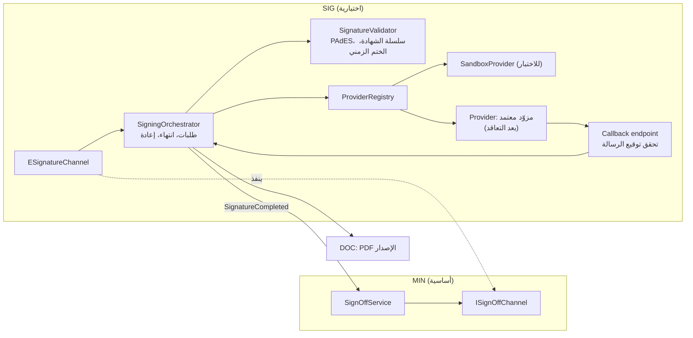
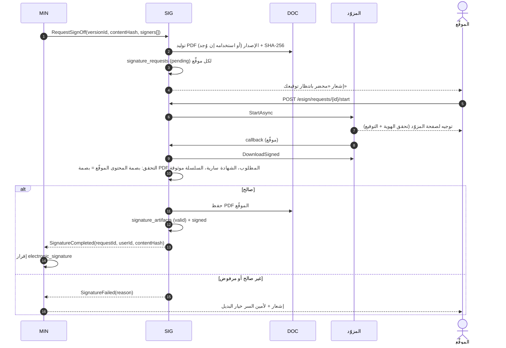

# 09 — وحدة التوقيع الإلكتروني الاختيارية (SIG)

## 0. الحالة المنفذة (2026-10-17)

نُفذت الوحدة مستقلة واختيارية (ADR-020)، وتفاصيل التسليم في 21 §1. ما تغير عن التصميم الأولي أدناه:

| التصميم الأولي | المنفذ |
|---|---|
| مستوى ثالث واحد `electronic_signature` | **ثلاثة أنواع منفصلة**: `in_app_approval` (موافقة موثقة داخل النظام، ليست توقيعًا رقميًا)، و`provider_esign` (عبر مزوّد خارجي)، و`pdf_digital_signature` (توقيع تشفيري على PDF) — 21 §2 |
| طلب لكل موقّع (`sig.signature_requests`) | طلب واحد لكل إصدار محضر بموقّعين ومراحل وتسلسل (`sig.requests` و`sig.signers`)، ومسارات قابلة للتهيئة لكل جهة أو نوع اجتماع (`sig.routes`) — 05 §3.20 |
| `ISignOffChannel` وأحداث | عقدان: `ISignatureGateway` (المحاضر تطلب) و`IMinutesSignatureSink` (الوحدة تُبلغ الاكتمال أو الرفض أو التحويل للبديل) |
| `SandboxProvider` | مزوّد تجريبي `mock` للاختبار فقط بجهة إصدار اختبارية، ممنوع في الإنتاج؛ وموصل `national_provider` يعلن «غير متكامل» (Q-09) |
| تحقق PAdES مع ختم زمني | تحقق فعلي من نطاق البايتات والبصمة والتوقيع وصلاحية الشهادة وسلسلة الثقة والتعديل اللاحق؛ **دون** ختم زمني موثوق ودون فحص الإلغاء — 21 §9 |
| تعطيل مع «اطلب بالبديل» لكل موقّع | تعطيل لا يغيّر حالة أي طلب؛ إجراء صريح لأمين السر: تعليق، أو تحويل الطلب كله للبديل مع بقاء التوقيعات المكتملة — 21 §7 |
| توقيع الرئيس بعد الاعتماد | التوقيعات (ومنها الرئيس) قبل الاعتماد النهائي، ضمن مرحلة التوقيع في سياسة الجهة |

الأقسام التالية هي التصميم الأولي وتبقى للمرجعية.

## 1. المبدأ

النظام يميّز ثلاثة مستويات لتأكيد الأعضاء على المحضر، ويعمل كاملًا بالمستويين الأول والثاني دون هذه الوحدة:

| المستوى | الطريقة (`minutes_signoffs.method`) | الوحدة | الحجية | متى يُستخدم |
|---|---|---|---|---|
| 1 | `attestation` — إقرار داخلي | MIN (أساسية) | إقرار موثق داخل النظام: هوية الدخول الموحد بتحقق ثنائي، والوقت، وبصمة الإصدار، وسجل تدقيق مقاوم للتلاعب. **ليس توقيعًا إلكترونيًا بالمعنى النظامي** (NFR-CMP-03) | الافتراضي لكل الجهات |
| 2 | `wet_signature_evidence` — دليل توقيع ورقي | MIN (أساسية) | التوقيع الورقي نفسه، والنظام يحفظ صورته وبصمتها ويربطها بالإصدار | عضو بلا حساب نشط، أو جهة تشترط التوقيع الورقي |
| 3 | `electronic_signature` — توقيع إلكتروني | **SIG (اختيارية)** | توقيع رقمي بشهادة صادرة من مزوّد معتمد، على ملف PDF بصيغة PAdES | جهات تشترط توقيعًا ذا حجية نظامية، بعد التعاقد مع مزوّد (Q-09) |

اختيار المستوى لكل جهة في `signoff_rule.methods` (ترتيب الأفضلية)، والمستوى 3 لا يُستخدم إلا إن كان `esign.attendee_signing` مفعلًا للجهة والمزوّد مهيأ.

## 2. حدود الوحدة

- تملك: `sig.signature_requests`، `sig.signature_artifacts`، `sig.provider_callbacks`.
- **لا تملك** حالة المحضر ولا قرار اكتمال الإقرارات؛ هذا لوحدة MIN. SIG تُبلغ النتيجة بحدث `SignatureCompleted` أو `SignatureFailed`، فتُسجل MIN إقرارًا بطريقة `electronic_signature` يحمل `signature_request_id`.
- تنفّذ منفذ MIN `ISignOffChannel` (03 §5.5).
- لا تعتمد عليها أي وحدة أساسية؛ تعتمد هي على عقود MIN وDOC وIAM.

## 3. المكونات



### 3.1 واجهة المزوّد

```csharp
public interface IESignatureProvider
{
    string Code { get; }
    Task<ProviderHealth> CheckAsync(CancellationToken ct);
    Task<StartSigningResult> StartAsync(SigningRequest request, CancellationToken ct);   // يعيد رابط توجيه أو رمز جلسة
    Task<ProviderStatus> GetStatusAsync(string providerRequestRef, CancellationToken ct);
    Task<CallbackResult> HandleCallbackAsync(HttpRequest request, CancellationToken ct);   // يتحقق من توقيع الرسالة
    Task<Stream> DownloadSignedAsync(string providerRequestRef, CancellationToken ct);
    Task CancelAsync(string providerRequestRef, CancellationToken ct);
}
```

`SigningRequest` يحمل: الموقِّع (بريده ومعرّفه الوطني **فقط إن تطلبه المزوّد وبموافقة**)، وPDF، وبصمته، وموضع التوقيع المرئي، والسبب («إقرار المحضر STC-2026-014 الإصدار 4»)، ومدة الصلاحية.

## 4. الدورة



### 4.1 حالات طلب التوقيع

`pending` → `sent` (بدأ الموقِّع) → `signed` | `declined` | `expired` | `failed`؛ و`cancelled` (إلغاء يدوي)، و`superseded` (تغيرت بصمة المحضر قبل التوقيع — يُلغى الطلب لدى المزوّد ويُنشأ جديد عند الطلب التالي).

### 4.2 توقيع الرئيس

إن فُعّل `esign.chair_signing` ونصت السياسة (`chair_esign_on_approval`): بعد الاعتماد وإصدار PDF النهائي يُنشأ طلب `signer_role=chair` على النسخة المعتمدة. **الاعتماد نافذ قبل توقيع الرئيس الإلكتروني**؛ التوقيع يضيف حجية للمستند ولا يغير حالة المحضر. لا يكتمل «PDF الموقّع» إلا بتوقيعه، ويظهر ذلك كشارة.

## 5. التعطيل وعدم فقد البيانات

| الموقف | السلوك |
|---|---|
| الوحدة معطلة منذ البداية | لا تظهر طريقة `electronic_signature`؛ المنفذ يعيد الإقرار الداخلي أو الدليل الورقي |
| تعطيل والطلبات جارية | الطلبات تبقى، وتتوقف المزامنة؛ MIN تعرض لأمين السر الموقّعين المتأثرين مع خيار «اطلب بالبديل» لكل منهم؛ الإقرارات الإلكترونية المكتملة تبقى صالحة لأنها مسجلة في MIN |
| إعادة التفعيل | تُستأنف المزامنة؛ الطلبات التي صار لها بديل تُلغى (`cancelled`) لأن MIN لا تقبل إقرارين صالحين للمستخدم والإصدار نفسيهما |
| تعطل المزوّد (لا تعطيل) | قاطع دائرة؛ حالة الموصل `failing`؛ الخيار نفسه لأمين السر |

## 6. الأمن

- استدعاءات المزوّد الراجعة: تحقق توقيع HMAC أو mTLS حسب المزوّد، ورفض المكرر (`provider_callbacks.payload_hash`)، وقائمة عناوين مسموحة.
- لا تُخزن بيانات اعتماد الموقِّع لدى المزوّد إطلاقًا.
- تقرير التحقق يُحفظ وقت التوقيع (`validation_report`) مع ختم زمني، وهو الدليل المعتمد؛ لا يُعاد التحقق دوريًا من النسخ المؤرشفة لأن انتهاء صلاحية الشهادة لاحقًا لا يُبطل توقيعًا تم وهي سارية (ASM-15).

## 7. ما يلزم لتفعيل المستوى 3

1. قرار المكتب بالحاجة لتوقيع ذي حجية نظامية لجهات بعينها، ومرجعه النظامي (Q-09).
2. اختيار مزوّد خدمة توقيع معتمد في المملكة والتعاقد معه، والحصول على وثائق واجهاته وبيئة اختبار وبيانات اعتماد.
3. تنفيذ `IESignatureProvider` للمزوّد واجتياز اختبارات الموصل (TS-31) على بيئة الاختبار.
4. ضبط `esign.provider` ثم تفعيل `module.esignature` ثم `esign.attendee_signing` لجهة تجريبية.

**حتى ذلك الحين، المزوّد الوحيد المنفذ هو `sandbox` للاختبار، ولا يُفعّل في الإنتاج** (NFR-SEC-12 يمنعه).
