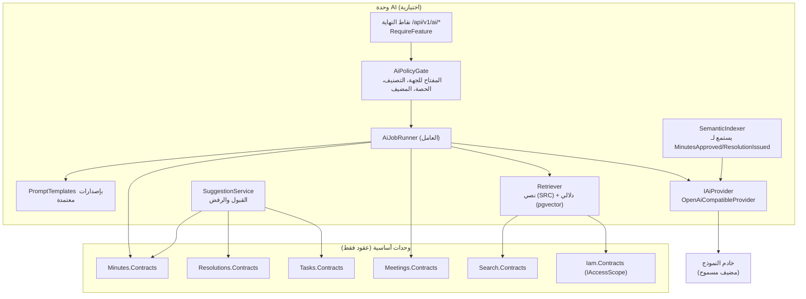
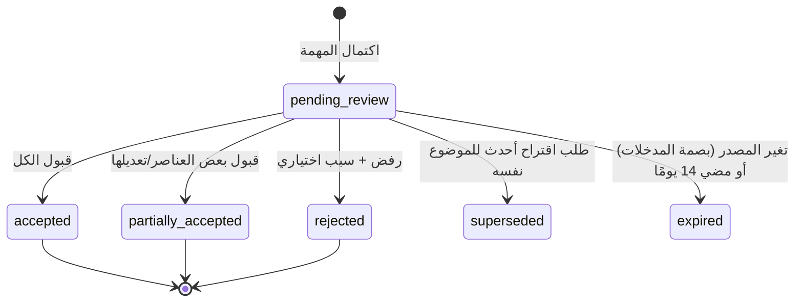

# 10 — وحدة الذكاء الاصطناعي الاختيارية (AI)

## 0. الحالة المنفذة (2026-10-18)

نُفذت الوحدة مستقلة واختيارية (ADR-021)، وتفاصيل التسليم في 22 §1. ما تغير عن التصميم الأولي أدناه:

| التصميم الأولي | المنفذ |
|---|---|
| مفاتيح `module.ai` و`ai.*` | المفاتيح الستة المعتمدة (`AI_ENABLED` وخمسة فرعية) و12 إعدادًا للمزوّد والحدود (07 §0)، والوظائف العشر موزعة عليها (22 §2) |
| القبول يستدعي أوامر الوحدات الأساسية بهوية القابل | لا مسار كتابة أساسي في الوحدة إطلاقًا: المستخدم ينشئ السجل بنفسه من نموذج معبأ بالمسودة عبر الواجهة الأساسية، ثم يُسجل «طُبّق منه» |
| `ai.ai_jobs` و`ai.ai_suggestions` و`ai.embeddings` و`ai.prompt_templates` و`ai.transcripts` | `ai.outputs` و`ai.requests` و`ai.jobs` و`ai.usage_alerts` (05 §3.21)؛ القوالب في الشيفرة بإصدار مسجل؛ ولا فهرسة دلالية |
| الاسترجاع النصي والدلالي (RRF) | بحث تقليدي أساسي بتطبيع عربي (`ISearchService`)، والبحث الذكي يفسر السؤال إلى مرشحات؛ والأسئلة تُجاب من بيانات يجلبها الخادم بحسب المقصد |
| `ai.max_classification` و`ai.allowed_hosts` | `AI_MAX_CLASSIFICATION` مع سقف «مقيد» للمزوّد الخارجي وحجب المعرّفات، و`Ai:AllowedHosts` في بيئة الخادم يقيد `AI_BASE_URL` |
| حصص يومية لكل مستخدم | حد يومي لكل مستخدم وحدان شهريان (طلبات ووحدات) وتنبيه المديرين عند الاقتراب والبلوغ |
| التعطيل: الطابور يُلغى | الجاري يُحجز ولا يُعرض حتى إفراج صريح، ومهام التفريغ المنتظرة تُحجز ولا تُستأنف آليًا (22 §5) |
| الترجمة | لم تُطلب في هذه المرحلة؛ غير منفذة |

الأقسام التالية هي التصميم الأولي وتبقى للمرجعية.

## 1. المبادئ الحاكمة

1. **اختيارية بالكامل:** النظام يعمل كاملًا ووحدة AI معطلة؛ لا وحدة أساسية تعتمد عليها (NFR-MNT-01).
2. **تساعد ولا تقرر:** كل مخرَج اقتراح بحالة `pending_review`، ولا يصبح بيانات رسمية إلا بقبول بشري مسجل يمر عبر أوامر الوحدات الأساسية وصلاحياتها (BRL-13).
3. **ضمن صلاحيات المستخدم:** لا يرى النموذج إلا ما يحق لطالب الاقتراح رؤيته، ولا يُرسل سجل يتجاوز `ai.max_classification`.
4. **سيادة البيانات:** لا يُرسل أي نص إلا إلى مضيف ضمن `ai.allowed_hosts` المقفلة من بيئة الخادم في الإنتاج، داخل المملكة.
5. **قابلية التتبع:** كل استدعاء مسجل (القدرة، النموذج، إصدار القالب، بصمة المدخلات، المستخدم، الزمن)، دون حفظ نصوص المدخلات في السجلات التشغيلية.
6. **إسناد لا اختلاق:** إجابات المساعد مسندة إلى مراجع استُرجعت فعليًا؛ مرجع غير مسترجع يُسقط، وإجابة بلا مراجع لا تُعرض كإجابة.

## 2. الحدود والمكونات



- تملك: `ai.ai_jobs`، `ai.ai_suggestions`، `ai.embeddings`، `ai.prompt_templates`، `ai.transcripts`.
- **تقرأ** بيانات الأساسية عبر العقود فقط، **وتكتب** فيها عبر أوامر العقود فقط عند القبول، بهوية المستخدم القابل وصلاحياته.
- مرشح للاستخراج كخدمة مستقلة لاحقًا إن احتاج عزلًا شبكيًا أو حسابيًا (ADR-001).

## 3. القدرات

| القدرة | المفتاح | من يطلبها | المدخلات | المخرج | التطبيق عند القبول |
|---|---|---|---|---|---|
| تلخيص المذكرة | `ai.memo_summary` | من يملك `agenda.view_materials` | نص المذكرة ومرفقاتها النصية | نقاط رئيسية، المطلوب من الجهة، أسئلة مقترحة | يُعرض ملخصًا معلَّمًا «آلي» بجانب المذكرة؛ لا يغير المذكرة |
| مسودة المحضر | `ai.minutes_draft` | أمين السر | بيانات الاجتماع المنظمة + ملاحظات المداولة + التفريغ إن وُجد | أقسام المحضر بالمخطط نفسه | استبدال أقسام مختارة في المسودة (source=`ai_assisted`) |
| استخراج القرارات والمهام | `ai.action_extraction` | أمين السر | نص المحضر + نتائج التصويت + دليل الموظفين والوحدات | قائمة {نوع، نص، بند، مكلَّف مقترح، موعد مقترح، ثقة} | إنشاء قرارات `proposed` ومهام `draft` للعناصر المقبولة فقط |
| المساعد | `ai.assistant_qa` | من يملك `search.query` | السؤال + ما يُسترجع ضمن صلاحياته | إجابة + مراجع (معرّفات وروابط) | لا يُطبَّق شيء؛ للقراءة |
| الترجمة | `ai.translation` | أمين السر | نص عربي أو إنجليزي | ترجمة | تعبئة الحقول `*_en` / `*_ar` المختارة |
| التفريغ الصوتي | `ai.transcription` | أمين السر | تسجيل بموافقة موثقة | نص | يُحفظ في `ai.transcripts` ليكون مدخلًا للمسودة |

### 3.1 مخططات الإخراج

كل قالب يحدد `output_schema` (JSON Schema)، ويُطلب من النموذج الإخراج المنظم، ويُرفض المخرج غير المطابق بعد محاولة تصحيح واحدة. مثال استخراج المهام:

```json
{
  "type": "object",
  "required": ["items"],
  "properties": {
    "items": { "type": "array", "items": {
      "type": "object",
      "required": ["kind", "text", "agendaPosition"],
      "properties": {
        "kind": { "enum": ["decision", "recommendation", "task"] },
        "text": { "type": "string", "maxLength": 2000 },
        "agendaPosition": { "type": "integer" },
        "suggestedAssignee": { "type": "object", "properties": {
          "type": { "enum": ["user", "org_unit", "external_entity", "unknown"] },
          "matchedId": { "type": ["string", "null"] }, "rawText": { "type": "string" } } },
        "suggestedDueDate": { "type": ["string", "null"], "format": "date" },
        "sourceQuote": { "type": "string", "maxLength": 300 }
      } } }
  }
}
```

`matchedId` يُتحقق منه في الخادم مقابل الدليل الفعلي؛ معرّف غير موجود يتحول إلى `unknown` ولا يُقبل كما هو.

## 4. المراجعة البشرية والتطبيق



- القبول يستدعي أوامر الوحدات الأساسية (مثل `IMinutesDraftEditor.ReplaceSections`) **بهوية القابل**، فتُطبق صلاحياته وقواعد الحالة؛ إن كان المحضر خرج من `draft` يُرفض القبول.
- ما قُبل يُعلّم `source = ai_assisted` في السجل الأساسي، ويُحفظ في `applied_refs` ما نتج عنه.
- استبدال مسودة المحضر الآلية لا يمحو الإدخال اليدوي: الواجهة تعرض الفروقات لكل قسم، والقبول على مستوى القسم (كما في الإصدار 0.5).

## 5. الاسترجاع (RAG) للمساعد

1. السؤال يُطبَّع عربيًا ويُبحث نصيًا عبر `ISearchService` (يطبق `IAccessScope` والتصنيف داخل الاستعلام).
2. إن كان `ai.semantic_index` مفعلًا: بحث تشابه في `ai.embeddings` **مع شرط** `body_id ∈ نطاق المستخدم` و`classification ≤ min(clearance, ai.max_classification)` في الاستعلام نفسه.
3. دمج النتائج (Reciprocal Rank Fusion)، وأعلى k مقطعًا.
4. **إن لم يُسترجع شيء لا يُستدعى النموذج**؛ يُعاد «لا توجد سجلات ضمن صلاحياتك تجيب عن هذا».
5. القالب يقدم المقاطع بمعرّفاتها ويطلب الإجابة بالإحالة إليها؛ الخادم يحذف أي إحالة لمعرّف لم يُقدم، ويرفض الإجابة إن خلت من إحالات.
6. يُعرض لكل إحالة رابط للسجل، والمستخدم لا يصل إلا لما يملكه أصلًا.

الفهرسة الدلالية تشمل فقط: المحاضر المعتمدة، والقرارات الصادرة، والمذكرات المنشورة. لا تُفهرس المسودات.

## 6. حماية البيانات والأمن

| الخطر | الضابط |
|---|---|
| إرسال بيانات لجهة خارجية غير معتمدة | `ai.allowed_hosts` مقفلة من البيئة؛ التحقق من المضيف قبل كل اتصال وبعد حل الاسم؛ رفض الإقلاع بإعداد مخالف في الإنتاج (NFR-SEC-12) |
| إرسال بيانات مصنفة | `ai.max_classification` (افتراضي `restricted`)؛ تجاوز الجهة يمكنه **خفض** الحد لا رفعه فوق العام |
| تسريب عبر الصلاحيات | الاسترجاع داخل نطاق المستخدم؛ اختبارات تسريب آلية (TS-41) |
| حقن التعليمات في المستندات | المحتوى يُمرر كبيانات محددة بوسوم؛ لا أدوات ولا استدعاءات وظائف يملكها النموذج؛ المخرج JSON يُتحقق منه بمخطط؛ لا يُنفذ أي شيء من المخرج تلقائيًا |
| الاحتفاظ لدى المزوّد | المزوّد داخلي أو بعقد يمنع الاحتفاظ والتدريب على البيانات (Q-16) |
| التحيز والأخطاء | علامة «آلي» دائمة، والمراجعة الإلزامية، ومقاييس جودة دورية (§9) |
| الكلفة والإساءة | حصص يومية لكل مستخدم، وحد تزامن للطابور، ومهلات |
| التسجيل الصوتي | لا تفريغ دون موافقة الحضور الموثقة في الاجتماع (`ai.transcripts.consent_confirmed_*`) |

## 7. خيارات استضافة النموذج (قرار مؤجل إلى مرحلة AI)

| الخيار | المزايا | العيوب |
|---|---|---|
| نموذج مفتوح الأوزان يدعم العربية، على خادم GPU داخل مركز بيانات المكتب عبر خادم استدلال بواجهة متوافقة مع OpenAI (مثل vLLM) | سيادة كاملة، لا كلفة لكل طلب، يقبل تصنيفًا أعلى | كلفة العتاد والتشغيل، وجودة أقل من النماذج الكبرى في بعض المهام |
| مزوّد سحابي معتمد داخل المملكة | لا عتاد، نماذج أقوى | يتطلب تقييمًا أمنيًا وعقدًا، وغالبًا حد تصنيف أدنى |

الوحدة لا تفترض أيًا منهما: `IAiProvider` بواجهة متوافقة مع OpenAI تغطي الحالتين. الاختيار يتم بتقييم على **مجموعة تقييم عربية** من محاضر المكتب المجهلة (Q-18): دقة الاستخراج، وأمانة الملخص، وجودة الصياغة العربية الرسمية، والزمن.

## 8. التفعيل والتعطيل

- `module.ai` معطل افتراضيًا، ويمكن قفله من البيئة حتى اكتمال التقييم الأمني.
- كل قدرة مفتاح مستقل، وتجاوز لكل جهة (مثلًا تعطيلها في جهة مصنفة `secret`).
- التعطيل: الطابور يُلغى، الاقتراحات تبقى للقراءة، لا تأثير على ما قُبل (07 §6).
- التفعيل لا يتطلب ترحيلًا؛ يتطلب فقط ضبط `ai.base_url` و`ai.model` ونجاح فحص الموصل. الفهرسة الدلالية تستكمل الأرشيف في الخلفية.

## 9. القياس والمراقبة

| المقياس | الهدف |
|---|---|
| نسبة قبول الاقتراحات (كلي/جزئي/رفض) لكل قدرة | متابعة القيمة الفعلية |
| نسبة تعديل النص بعد القبول | مؤشر الجودة |
| دقة استخراج القرارات على مجموعة التقييم (precision/recall) | ≥ 0.85 قبل التفعيل في الإنتاج |
| إحالات مرفوضة في المساعد | قريبة من الصفر |
| زمن p95 لكل قدرة | مسودة المحضر < 60 ثانية |
| محاولات محجوبة (تصنيف/مضيف/حصة) | تنبيه عند الارتفاع |

## 10. تسلسل الإدخال

1. **المرحلة 7أ:** البنية (الجداول، المنافذ، المفاتيح، المزوّد التجريبي `mock` للاختبارات فقط) — ضمن البناء الأساسي حتى يكون التفعيل لاحقًا دون ترحيل.
2. **المرحلة 7ب:** بعد توفر خادم النموذج: تلخيص المذكرات، ثم استخراج القرارات والمهام، ثم مسودة المحضر، ثم المساعد. لجهة تجريبية واحدة أولًا.
3. **لاحقًا:** الترجمة، ثم التفريغ الصوتي بعد تقييم دقته على اللهجة المحلية.
