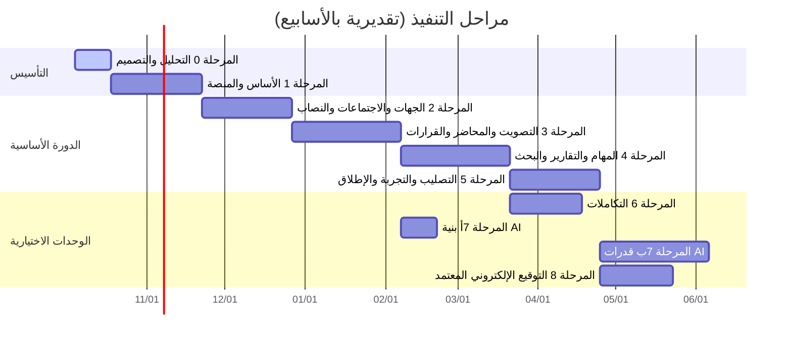

# 13 — مراحل التنفيذ

## 1. الافتراضات التخطيطية

- فريق مقترح: قائد تقني/معماري، مطورا خلفية .NET، مطور واجهة React، محلل أعمال/مختبر، مع دعم جزئي من البنية التحتية والأمن السيبراني (ASM-17). المدد تقديرية بالأسابيع لهذا الفريق وتُراجع بعد المرحلة 1.
- تسليم تدريجي: كل مرحلة تنتهي ببيئة اختبار عاملة وعرض على ممثلي المستخدمين.
- الوحدات الاختيارية تُبنى **بنيتها** (الجداول، المنافذ، المفاتيح) في المراحل الأولى حتى يكون تفعيلها لاحقًا دون ترحيل.

## 2. المراحل

| المرحلة | المخرجات | المتطلبات | بوابة الخروج |
|---|---|---|---|
| **0 التحليل والتصميم** | هذه الوثائق | — | اعتماد المكتب للوثائق والإجابة على أسئلة المرحلة 1 في 16 |
| **1 الأساس والمنصة** | هيكل الحل والوحدات، CI/CD، اختبارات المعمارية، الدخول الموحد BFF، الصلاحيات و`IAccessScope`، الإعدادات المركزية ولوحتها، التدقيق بسلسلة البصمات، الصادر والإشعارات الداخلية، المستندات (نظام الملفات)، الهيكل التنظيمي، العربية/RTL/الهجري، صحة النظام، Docker Compose، الجداول الفارغة لـ `sig`/`ai`/`integ` | FR-IAM-*، FR-ORG-01..02، FR-ADM-*، FR-AUD-*، FR-NTF-01..06، FR-DOC-01..06 | دخول بحساب المكتب على بيئة الاختبار؛ TS-01، TS-21، TS-34، TS-35، TS-36 ناجحة |
| **2 الجهات والاجتماعات والنصاب** | تشكيل الجهات والسياسات بإصدارات، العضويات والتفويض، الاجتماعات والجدول والدعوات (بريد عبر الصادر + .ics)، الحضور والنصاب وتعارض المصالح | FR-BOD-*، FR-MTG-*، FR-ATT-* | TS-04..TS-11، TS-38 ناجحة؛ عرض على أمين سر تجريبي |
| **3 التصويت والمحاضر والقرارات** | المداولات، المقترحات، التصويت بأنواعه، التمرير، المحاضر بإصداراتها وبصمتها، الإقرار الداخلي والدليل الورقي، الاعتماد في معاملة، PDF ورمز التحقق، التصحيح، سجل القرارات، المنافذ الافتراضية لـ SIG | FR-DLB-*، FR-MIN-*، FR-RES-*، FR-SIG-01، FR-SIG-06 | TS-12..TS-19، TS-22، TS-23 ناجحة؛ دورة كاملة لاجتماع تجريبي |
| **4 المهام والتقارير والبحث** | المهام والإسناد والتحقق والتمديد والتصعيد، اللوحات والتقارير والتصدير، البحث العربي والأرشفة والحجز | FR-TSK-*، FR-RPT-*، FR-SRC-* | TS-24..TS-30، TS-32، TS-33 ناجحة؛ **MVP مكتمل** |
| **5 التصليب والتجربة والإطلاق** | اختبار الأداء والأمن والإتاحة والاستعادة، ترحيل بيانات 0.5 إن لزم، تجربة مع جهتين (مع إقرار وبدونه)، التدريب، دليل التشغيل، الإطلاق على النطاق الرسمي | NFR-*، TS-20، TS-43 | معايير الخروج في 12 §5 |
| **6 التكاملات** | Graph بريد وتقويم (أو SMTP)، مزامنة Entra، SharePoint، ثم قمم وERP والرسائل النصية **عند توفر واجهاتها** | FR-INT-01..04، FR-INT-06..08، FR-NTF-07، FR-ORG-03 | TS-37، TS-39 على المحاكيات ثم على بيئة اختبار الجهة المالكة؛ لا تفعيل في الإنتاج دون ذلك |
| **7أ بنية AI** | الجداول، المنافذ، `AiPolicyGate`، مزوّد `mock`، القوالب بإصدارات، نقاط النهاية خلف المفاتيح | FR-AI-01، FR-AI-07..09 | TS-20 (F2)، TS-41 على `mock` |
| **7ب قدرات AI** | بعد توفر خادم النموذج وتقييمه: التلخيص، الاستخراج، المسودة، المساعد، الترجمة؛ والتفريغ لاحقًا | FR-AI-02..06، FR-AI-10 | معايير 10 §9 على مجموعة التقييم العربية؛ تجربة جهة واحدة |
| **8 التوقيع المعتمد** | مزوّد التوقيع المتعاقد معه، توقيع الحاضرين والرئيس | FR-SIG-02..05، FR-SIG-07، FR-INT-05 | TS-31 على بيئة المزوّد؛ موافقة الشؤون القانونية |

## 2.1 حالة المراحل

| المرحلة | الحالة | المرجع |
|---|---|---|
| 0 التحليل والتصميم | مكتملة | هذه الوثائق |
| 1 الأساس والمنصة | **مكتملة** (2026-10-16) — مع الهيكل الأساسي لصفحات المراحل 2–4 مرتبطًا بالقاعدة | [17-phase1-delivery](17-phase1-delivery.md) |
| 2 المجالس واللجان والاجتماعات | **مكتملة** (2026-10-16) — الجهات بأنواعها الثمانية، والعضويات والبدلاء والتفويض، والاجتماعات والدعوات والحضور والنصاب وجدول الأعمال؛ عدا FR-MTG-04 وFR-ATT-06 وFR-ATT-07 وFR-BOD-08 | [18-phase2-delivery](18-phase2-delivery.md) |
| 3 المحاضر والقرارات والتصويت | **مكتملة** (2026-10-16) — محرر المحاضر بالقوالب، ودورة الاعتماد القابلة للتهيئة مع المسار البديل، والإصدارات والتعديل الموثق، وسجل القرارات، والتصويت بطرقه، وPDF؛ عدا FR-DLB-01 وFR-RES-06 (التصدير) ورمز QR في FR-MIN-09 | [19-phase3-delivery](19-phase3-delivery.md) |
| 4 المهام والتكليفات | **مكتملة** (2026-10-16) — بطاقة المهمة بمنفذ ومتابع منفصلين، ودورة حالات وصلاحيات قابلة للتهيئة، والمخرجات والتحقق، والتمديد، والتصعيد بمستويات السياسة، وبوابة الجهات الاختيارية، وخطاب التكليف، ولوحات المهام؛ عدا FR-TSK-11 وFR-TSK-12، والتقارير التنفيذية والبحث الشامل (تُنقل للمرحلة التالية) | [20-phase4-delivery](20-phase4-delivery.md) |
| وحدة التوقيع الإلكتروني | **مكتملة تقنيًا** (2026-10-17) — وحدة مستقلة اختيارية بثلاثة أنواع، ومسارات لكل جهة أو نوع، وPDF موقّع تشفيريًا مع التحقق، وواجهة مزوّد ومزوّد تجريبي، وتعطيل بإجراء صريح؛ **غير معتمدة نظاميًا** حتى التعاقد مع مزوّد معتمد ومراجعة الشؤون القانونية (Q-09) | [21-esignature-delivery](21-esignature-delivery.md) |
| وحدة الذكاء الاصطناعي | **مكتملة تقنيًا** (2026-10-18) — وحدة مستقلة اختيارية بالوظائف العشر، وموصل متوافق مع OpenAI، وسياسة تصنيف وتقليل، ومخزن أسرار، وحدود وتنبيهات، وسجل تشغيل دون محتوى، وتحقق خادمي من المراجع، وبحث تقليدي أساسي؛ **دون نموذج معتمد متصل** حتى قرار الاستضافة (Q-16) والتقييم العربي (Q-18) | [22-ai-delivery](22-ai-delivery.md) |

## 3. ما يُسلّم في كل مرحلة

- الشيفرة في المستودع مع اختباراتها وترحيلاتها.
- ملف OpenAPI المحدث وعميل TypeScript المولد.
- تحديث هذه الوثائق إن تغير تصميم (مع سجل ADR للقرارات الجديدة).
- ملاحظات الإصدار وبيئة اختبار محدثة.

## 4. التسليم والتشغيل بعد الإطلاق

- نقل المعرفة لفريق التقنية بالمكتب: بنية الحل، إضافة وحدة، إضافة مزوّد، الترحيلات، التشغيل والاستعادة.
- فترة دعم مستقرة (Hypercare) 4 أسابيع بعد الإطلاق.
- مراجعة مؤشرات 01 §2 بعد 3 و6 أشهر.
